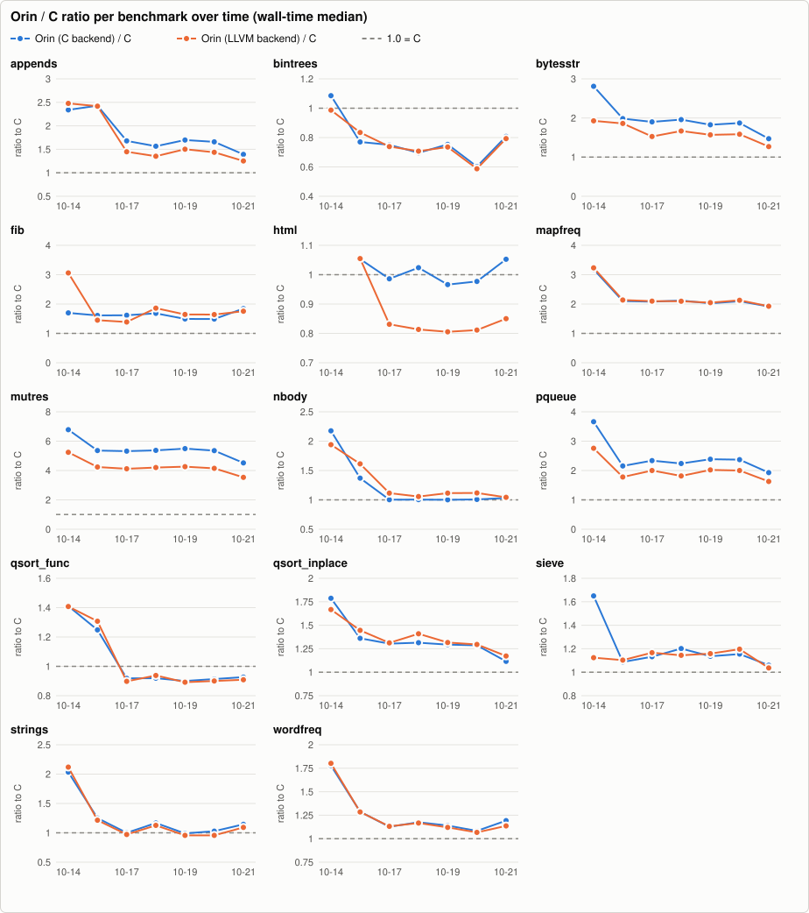
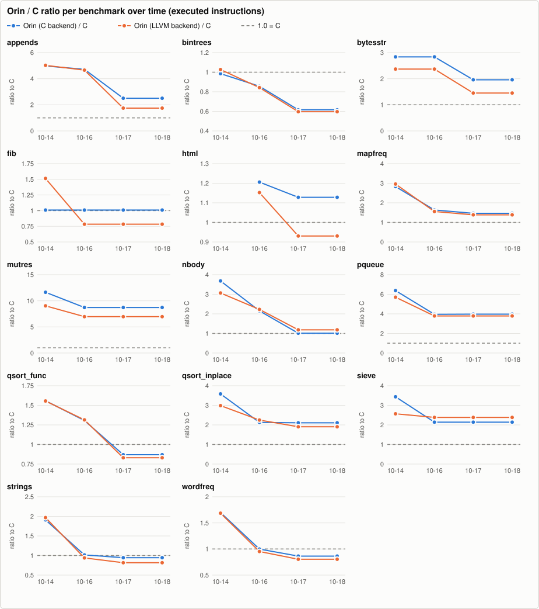
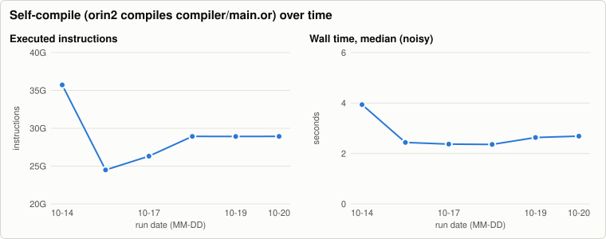
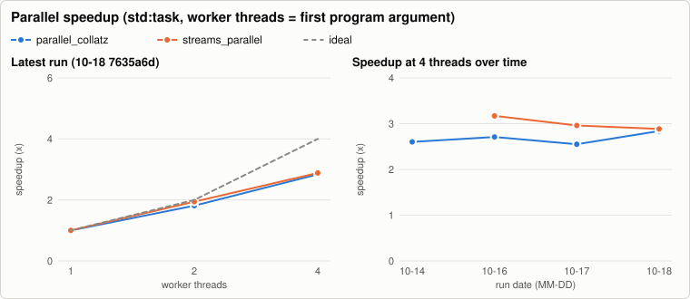

# Orin benchmark history

Written by `.github/workflows/bench.yml` (nightly and manual runs on `main`); one JSON file per run in [`history/`](history/), charts rendered by `tooling/benchmarks` (`bench-report render`, no external services). The same data as a stand-alone page: [`report.html`](report.html). Metrics and methodology: `docs/benchmarks.md` on `main`. Do not edit this branch by hand.

15 runs, 2026-10-14 to 2026-10-29. Latest: [`7635a6de4b`](https://github.com/HenrySchwerdt/orin/commit/7635a6de4ba00d5f68f1c6355860428eaad22201).

Instruction counts are the regression metric: they are deterministic for single-threaded programs, while wall time on a shared runner moves by 10-25 % between identical binaries.

## Latest run

Commit `7635a6de4b` (main), 2026-10-29T10:57:02Z. Machine: AMD EPYC 7763 64-Core Processor, 4 cores, 15.6 GiB, Linux-7.0.0-1017-azure-x86_64-with-glibc2.39. Runs per cell: 5 (median after one warm-up).

Tool versions

- cc: `cc (Ubuntu 13.3.0-6ubuntu2~24.04.1) 13.3.0`
- clang: `Ubuntu clang version 18.1.3 (1ubuntu1)`
- go: `go version go1.24.13 linux/amd64`
- java: `openjdk version "21.0.13" 2026-10-20 LTS`
- python: `3.12.3`
- rustc: `rustc 1.99.1 (58cf8f9c3 2026-10-13)`
- valgrind: `valgrind-3.22.0`

### Wall time, seconds (median; min-max)

| benchmark | Orin (C backend) | Orin (LLVM backend) | C | Go | Java | Rust |
|---|---:|---:|---:|---:|---:|---:|
| appends | 0.009 (0.009-0.009) | 0.008 (0.007-0.008) | 0.005 (0.005-0.005) | 0.014 (0.012-0.017) | 0.071 (0.063-0.073) | 0.005 (0.005-0.005) |
| bintrees | 0.409 (0.405-0.424) | 0.402 (0.397-0.406) | 0.678 (0.672-0.681) | 1.308 (1.300-1.325) | 0.337 (0.336-0.339) | 0.705 (0.705-0.708) |
| bytesstr | 0.039 (0.039-0.041) | 0.034 (0.034-0.035) | 0.025 (0.025-0.026) | 0.010 (0.008-0.014) | 0.100 (0.098-0.107) | 0.039 (0.039-0.039) |
| fib | 0.296 (0.295-0.299) | 0.326 (0.326-0.328) | 0.198 (0.198-0.198) | 0.576 (0.565-0.579) | 0.421 (0.417-0.431) | 0.315 (0.314-0.320) |
| html | 0.164 (0.163-0.165) | 0.136 (0.134-0.138) | 0.167 (0.165-0.168) | 0.240 (0.232-0.253) | n/a | n/a |
| html_hand | 0.129 (0.127-0.133) | 0.103 (0.102-0.105) | n/a | n/a | n/a | n/a |
| http_parse | 0.129 (0.129-0.129) | 0.117 (0.117-0.125) | n/a | n/a | n/a | n/a |
| mapfreq | 0.155 (0.154-0.156) | 0.160 (0.156-0.160) | 0.076 (0.076-0.077) | 0.117 (0.116-0.118) | n/a | n/a |
| mutres | 0.174 (0.174-0.176) | 0.134 (0.134-0.135) | 0.032 (0.032-0.032) | 0.045 (0.044-0.045) | 0.088 (0.081-0.090) | 0.038 (0.038-0.038) |
| nbody | 0.070 (0.070-0.071) | 0.078 (0.078-0.078) | 0.070 (0.070-0.070) | 0.088 (0.087-0.089) | n/a | n/a |
| pqueue | 0.147 (0.147-0.149) | 0.125 (0.125-0.127) | 0.063 (0.063-0.064) | 0.202 (0.198-0.207) | 0.251 (0.234-0.252) | 0.090 (0.089-0.092) |
| qsort_func | 0.218 (0.215-0.224) | 0.213 (0.212-0.214) | 0.235 (0.235-0.238) | 0.398 (0.374-0.410) | n/a | n/a |
| qsort_inplace | 0.109 (0.109-0.111) | 0.110 (0.110-0.111) | 0.087 (0.086-0.087) | 0.114 (0.106-0.124) | n/a | n/a |
| sieve | 0.126 (0.123-0.128) | 0.127 (0.125-0.136) | 0.122 (0.113-0.131) | 0.325 (0.293-0.381) | 0.182 (0.177-0.186) | 0.115 (0.114-0.118) |
| sortedmap | 0.248 (0.247-0.250) | 0.259 (0.259-0.261) | n/a | n/a | n/a | n/a |
| streams | 0.133 (0.131-0.133) | 0.110 (0.109-0.111) | n/a | n/a | n/a | n/a |
| strings | 0.077 (0.076-0.078) | 0.073 (0.072-0.074) | 0.076 (0.076-0.076) | 0.086 (0.078-0.089) | 0.241 (0.235-0.247) | 0.031 (0.031-0.032) |
| tasks | 4.146 (4.128-4.226) | 4.098 (4.065-4.144) | n/a | n/a | n/a | n/a |
| url | 0.379 (0.378-0.388) | 0.344 (0.343-0.349) | n/a | n/a | n/a | n/a |
| wordfreq | 0.126 (0.126-0.127) | 0.126 (0.124-0.126) | 0.112 (0.110-0.113) | 0.118 (0.117-0.118) | n/a | n/a |

### Ratio to C (wall-time median; lower is better, 1.00x = as fast as C)

| benchmark | Orin C/C | Orin LLVM/C | Go/C | Java/C | Rust/C |
|---|---:|---:|---:|---:|---:|
| appends | 1.63x | 1.43x | 2.58x | 13.44x | 0.90x |
| bintrees | 0.60x | 0.59x | 1.93x | 0.50x | 1.04x |
| bytesstr | 1.54x | 1.37x | 0.38x | 3.98x | 1.54x |
| fib | 1.49x | 1.65x | 2.91x | 2.12x | 1.59x |
| html | 0.98x | 0.82x | 1.44x | n/a | n/a |
| html_hand | n/a | n/a | n/a | n/a | n/a |
| http_parse | n/a | n/a | n/a | n/a | n/a |
| mapfreq | 2.03x | 2.10x | 1.53x | n/a | n/a |
| mutres | 5.49x | 4.25x | 1.42x | 2.79x | 1.20x |
| nbody | 1.00x | 1.12x | 1.26x | n/a | n/a |
| pqueue | 2.32x | 1.98x | 3.18x | 3.95x | 1.42x |
| qsort_func | 0.93x | 0.91x | 1.69x | n/a | n/a |
| qsort_inplace | 1.26x | 1.28x | 1.31x | n/a | n/a |
| sieve | 1.04x | 1.04x | 2.66x | 1.49x | 0.94x |
| sortedmap | n/a | n/a | n/a | n/a | n/a |
| streams | n/a | n/a | n/a | n/a | n/a |
| strings | 1.02x | 0.96x | 1.13x | 3.18x | 0.42x |
| tasks | n/a | n/a | n/a | n/a | n/a |
| url | n/a | n/a | n/a | n/a | n/a |
| wordfreq | 1.13x | 1.12x | 1.05x | n/a | n/a |

### CPU time (user + sys, median s) and peak RSS (MiB)

| benchmark | orin CPU | llvm CPU | c CPU | go CPU | java CPU | rust CPU | orin RSS | llvm RSS | c RSS | go RSS | java RSS | rust RSS |
|---|---:|---:|---:|---:|---:|---:|---:|---:|---:|---:|---:|---:|
| appends | 0.008 | 0.007 | 0.005 | 0.020 | 0.110 | 0.005 | 4.5 | 4.8 | 4.7 | 9.1 | 47.6 | 5.0 |
| bintrees | 0.408 | 0.402 | 0.678 | 2.832 | 0.393 | 0.705 | 17.5 | 17.8 | 9.5 | 12.4 | 301.1 | 10.0 |
| bytesstr | 0.039 | 0.034 | 0.025 | 0.015 | 0.121 | 0.039 | 11.5 | 11.8 | 11.6 | 6.3 | 102.8 | 4.8 |
| fib | 0.295 | 0.326 | 0.198 | 0.578 | 0.432 | 0.315 | 1.5 | 1.7 | 1.5 | 1.7 | 38.6 | 1.9 |
| html | 0.163 | 0.136 | 0.166 | 0.319 | n/a | n/a | 3.7 | 4.1 | 2.1 | 7.5 | n/a | n/a |
| html_hand | 0.129 | 0.102 | n/a | n/a | n/a | n/a | 2.4 | 2.8 | n/a | n/a | n/a | n/a |
| http_parse | 0.129 | 0.117 | n/a | n/a | n/a | n/a | 1.6 | 2.0 | n/a | n/a | n/a | n/a |
| mapfreq | 0.155 | 0.159 | 0.076 | 0.133 | n/a | n/a | 11.3 | 11.6 | 5.0 | 7.6 | n/a | n/a |
| mutres | 0.173 | 0.134 | 0.031 | 0.045 | 0.116 | 0.038 | 1.5 | 1.7 | 1.5 | 1.6 | 38.9 | 2.0 |
| nbody | 0.070 | 0.078 | 0.070 | 0.089 | n/a | n/a | 1.7 | 1.7 | 1.8 | 1.7 | n/a | n/a |
| pqueue | 0.147 | 0.125 | 0.063 | 0.215 | 0.322 | 0.090 | 6.1 | 6.3 | 4.7 | 14.8 | 62.0 | 5.0 |
| qsort_func | 0.218 | 0.213 | 0.235 | 0.502 | n/a | n/a | 36.4 | 36.7 | 23.7 | 37.6 | n/a | n/a |
| qsort_inplace | 0.109 | 0.110 | 0.086 | 0.137 | n/a | n/a | 16.7 | 17.0 | 16.7 | 28.5 | n/a | n/a |
| sieve | 0.126 | 0.126 | 0.122 | 0.518 | 0.208 | 0.115 | 77.7 | 78.0 | 77.6 | 239.3 | 115.9 | 78.2 |
| sortedmap | 0.248 | 0.259 | n/a | n/a | n/a | n/a | 11.1 | 11.4 | n/a | n/a | n/a | n/a |
| streams | 0.132 | 0.110 | n/a | n/a | n/a | n/a | 39.6 | 39.9 | n/a | n/a | n/a | n/a |
| strings | 0.077 | 0.073 | 0.075 | 0.116 | 0.469 | 0.031 | 46.1 | 46.4 | 34.6 | 23.2 | 139.2 | 19.9 |
| tasks | 4.960 | 4.817 | n/a | n/a | n/a | n/a | 14.1 | 14.5 | n/a | n/a | n/a | n/a |
| url | 0.379 | 0.343 | n/a | n/a | n/a | n/a | 6.4 | 6.7 | n/a | n/a | n/a | n/a |
| wordfreq | 0.126 | 0.126 | 0.112 | 0.120 | n/a | n/a | 2.2 | 2.6 | 1.9 | 6.7 | n/a | n/a |

### Executed instructions (valgrind; the regression metric)

| benchmark | Orin C | Orin LLVM | C | Orin C/C | Orin LLVM/C | note |
|---|---:|---:|---:|---:|---:|---|
| appends | 63,530,238 | 44,305,230 | 25,381,145 | 2.50x | 1.75x |  |
| bintrees | 4,457,305,570 | 4,319,515,260 | 7,242,293,419 | 0.62x | 0.60x |  |
| bytesstr | 349,907,901 | 259,441,192 | 178,695,483 | 1.96x | 1.45x |  |
| fib | 3,200,318,149 | 2,483,953,789 | 3,170,983,201 | 1.01x | 0.78x |  |
| html | 1,784,203,898 | 1,471,870,961 | 1,581,660,486 | 1.13x | 0.93x |  |
| html_hand | 1,332,890,905 | 987,886,023 | n/a | n/a | n/a |  |
| http_parse | 1,539,178,551 | 1,358,991,092 | n/a | n/a | n/a |  |
| mapfreq | 1,050,624,793 | 995,125,501 | 717,968,435 | 1.46x | 1.39x |  |
| mutres | 2,541,530,953 | 2,030,255,622 | 291,450,138 | 8.72x | 6.97x |  |
| nbody | 658,315,507 | 772,258,291 | 651,230,691 | 1.01x | 1.19x |  |
| pqueue | 1,411,252,308 | 1,344,413,179 | 355,213,580 | 3.97x | 3.78x |  |
| qsort_func | 1,329,379,242 | 1,269,367,690 | 1,528,677,747 | 0.87x | 0.83x |  |
| qsort_inplace | 576,878,264 | 521,077,504 | 273,751,964 | 2.11x | 1.90x |  |
| sieve | 410,343,285 | 456,726,097 | 191,756,537 | 2.14x | 2.38x |  |
| sortedmap | 1,356,615,053 | 1,358,427,068 | n/a | n/a | n/a |  |
| streams | 1,173,755,264 | 1,173,731,319 | n/a | n/a | n/a |  |
| strings | 647,532,817 | 559,940,890 | 685,893,530 | 0.94x | 0.82x |  |
| tasks | n/a | n/a | n/a | n/a | n/a | llvm skipped: multi-threaded (20,000 tasks, channels): valgrind serialises threads, so the count would include scheduler waits; orin skipped: multi-threaded (20,000 tasks, channels): valgrind serialises threads, so the count would include scheduler waits |
| url | 4,852,179,714 | 4,363,458,753 | n/a | n/a | n/a |  |
| wordfreq | 760,378,206 | 707,684,209 | 880,488,789 | 0.86x | 0.80x |  |

### Parallel speedup (std:task; worker threads = first argument of the program)

| benchmark | threads | wall s (min-max) | CPU s (user+sys) | speedup | efficiency | CPU vs 1 thread | output |
|---|---:|---:|---:|---:|---:|---:|---|
| parallel_collatz | 1 | 0.501 (0.500-0.501) | 0.500 | 1.00x | 100 % | 1.00x | same |
| parallel_collatz | 2 | 0.296 (0.295-0.297) | 0.535 | 1.69x | 85 % | 1.07x | same |
| parallel_collatz | 4 | 0.193 (0.191-0.194) | 0.644 | 2.60x | 65 % | 1.29x | same |
| streams_parallel | 1 | 0.491 (0.491-0.497) | 0.490 | 1.00x | 100 % | 1.00x | same |
| streams_parallel | 2 | 0.259 (0.259-0.268) | 0.492 | 1.90x | 95 % | 1.00x | same |
| streams_parallel | 4 | 0.183 (0.183-0.185) | 0.657 | 2.68x | 67 % | 1.34x | same |

Speedup = wall(1 thread) / wall(n); efficiency = speedup / n. CPU time that grows with n is overhead or oversubscription (more threads than free cores).

### Self-compile (orin2 compiles compiler/main.or)

| wall s (min-max) | CPU s | peak RSS MiB | instructions | output identical to stage2.c |
|---:|---:|---:|---:|---|
| 2.725 (2.682-2.748) | 4.833 | 393.9 | 28,928,714,860 | yes |

## All runs

| date | commit | ref | self-compile instructions | self-compile wall s | file |
|---|---|---|---:|---:|---|
| 2026-10-29T10:57:02Z | `7635a6de4b` | main | 28,928,714,860 | 2.725 | [json](history/2026-10-29-7635a6de4ba0.json) |
| 2026-10-28T10:34:30Z | `7635a6de4b` | main | 28,927,700,571 | 2.775 | [json](history/2026-10-28-7635a6de4ba0.json) |
| 2026-10-27T09:54:38Z | `7635a6de4b` | main | 28,929,325,676 | 2.422 | [json](history/2026-10-27-7635a6de4ba0.json) |
| 2026-10-26T09:51:57Z | `7635a6de4b` | main | 28,898,057,347 | 2.328 | [json](history/2026-10-26-7635a6de4ba0.json) |
| 2026-10-25T09:10:57Z | `7635a6de4b` | main | 28,925,568,576 | 2.594 | [json](history/2026-10-25-7635a6de4ba0.json) |
| 2026-10-24T08:51:56Z | `7635a6de4b` | main | 28,924,241,295 | 2.708 | [json](history/2026-10-24-7635a6de4ba0.json) |
| 2026-10-23T09:21:38Z | `7635a6de4b` | main | 28,928,848,177 | 2.577 | [json](history/2026-10-23-7635a6de4ba0.json) |
| 2026-10-22T09:18:06Z | `7635a6de4b` | main | 28,927,908,288 | 1.939 | [json](history/2026-10-22-7635a6de4ba0.json) |
| 2026-10-21T09:16:22Z | `7635a6de4b` | main | 28,929,128,127 | 2.146 | [json](history/2026-10-21-7635a6de4ba0.json) |
| 2026-10-20T09:21:19Z | `7635a6de4b` | main | 28,924,224,488 | 2.688 | [json](history/2026-10-20-7635a6de4ba0.json) |
| 2026-10-19T09:49:07Z | `7635a6de4b` | main | 28,920,330,777 | 2.632 | [json](history/2026-10-19-7635a6de4ba0.json) |
| 2026-10-18T08:43:59Z | `7635a6de4b` | main | 28,927,449,240 | 2.360 | [json](history/2026-10-18-7635a6de4ba0.json) |
| 2026-10-17T08:29:19Z | `d0a17a9682` | main | 26,314,861,202 | 2.370 | [json](history/2026-10-17-d0a17a968285.json) |
| 2026-10-16T08:55:17Z | `9f83f16af4` | main | 24,496,056,957 | 2.438 | [json](history/2026-10-16-9f83f16af402.json) |
| 2026-10-14T17:32:27Z | `f837889af7` | main | 35,729,157,194 | 3.937 | [json](history/2026-10-14-f837889af7a9.json) |
