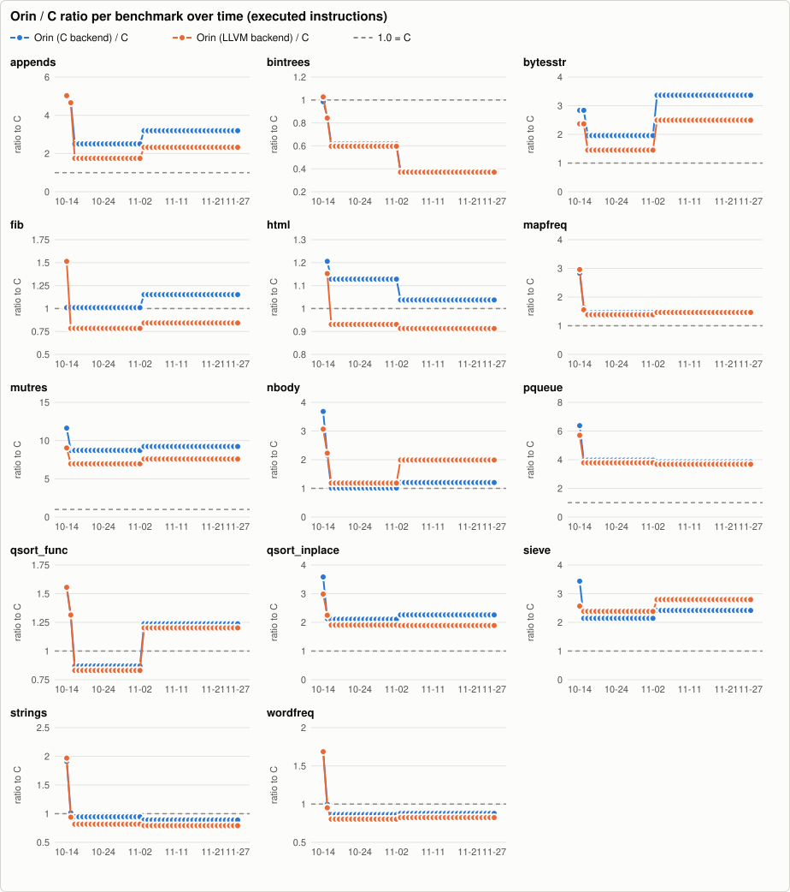

# Orin benchmark history

Written by `.github/workflows/bench.yml` (nightly and manual runs on `main`); one JSON file per run in [`history/`](history/), charts rendered by `tooling/benchmarks` (`bench-report render`, no external services). The same data as a stand-alone page: [`report.html`](report.html). Metrics and methodology: `docs/benchmarks.md` on `main`. Do not edit this branch by hand.

34 runs, 2026-10-14 to 2026-11-17. Latest: [`7635a6de4b`](https://github.com/HenrySchwerdt/orin/commit/7635a6de4ba00d5f68f1c6355860428eaad22201).

Instruction counts are the regression metric: they are deterministic for single-threaded programs, while wall time on a shared runner moves by 10-25 % between identical binaries.

## Latest run

Commit `7635a6de4b` (main), 2026-11-17T12:57:26Z. Machine: AMD EPYC 9V74 80-Core Processor, 4 cores, 15.6 GiB, Linux-7.0.0-1019-azure-x86_64-with-glibc2.43. Runs per cell: 5 (median after one warm-up).

Tool versions

- cc: `cc (Ubuntu 15.2.0-16ubuntu1) 15.2.0`
- clang: `Ubuntu clang version 21.1.8 (6ubuntu1)`
- go: `go version go1.24.13 linux/amd64`
- java: `openjdk version "21.0.13" 2026-10-20 LTS`
- python: `3.14.4`
- rustc: `rustc 1.100.0 (0ef1bc386 2026-11-09)`
- valgrind: `valgrind-3.26.0`

### Wall time, seconds (median; min-max)

| benchmark | Orin (C backend) | Orin (LLVM backend) | C | Go | Java | Rust |
|---|---:|---:|---:|---:|---:|---:|
| appends | 0.007 (0.007-0.007) | 0.006 (0.006-0.006) | 0.004 (0.004-0.004) | 0.009 (0.007-0.011) | 0.059 (0.054-0.063) | 0.003 (0.003-0.003) |
| bintrees | 0.335 (0.333-0.343) | 0.319 (0.314-0.324) | 0.844 (0.837-0.853) | 0.994 (0.978-1.011) | 0.277 (0.273-0.282) | 0.952 (0.949-0.961) |
| bytesstr | 0.032 (0.032-0.032) | 0.028 (0.027-0.028) | 0.018 (0.017-0.020) | 0.007 (0.007-0.008) | 0.079 (0.078-0.094) | 0.032 (0.030-0.034) |
| fib | 0.217 (0.216-0.223) | 0.273 (0.273-0.279) | 0.134 (0.134-0.144) | 0.521 (0.513-0.527) | 0.321 (0.314-0.325) | 0.272 (0.272-0.285) |
| html | 0.129 (0.126-0.137) | 0.105 (0.102-0.110) | 0.115 (0.113-0.119) | 0.187 (0.180-0.200) | n/a | n/a |
| html_hand | 0.104 (0.103-0.104) | 0.081 (0.077-0.081) | n/a | n/a | n/a | n/a |
| http_parse | 0.094 (0.093-0.095) | 0.081 (0.080-0.082) | n/a | n/a | n/a | n/a |
| mapfreq | 0.120 (0.119-0.121) | 0.120 (0.119-0.121) | 0.060 (0.059-0.073) | 0.092 (0.088-0.113) | n/a | n/a |
| mutres | 0.144 (0.144-0.145) | 0.117 (0.116-0.118) | 0.032 (0.032-0.032) | 0.036 (0.036-0.037) | 0.069 (0.067-0.074) | 0.033 (0.032-0.033) |
| nbody | 0.055 (0.054-0.055) | 0.064 (0.064-0.066) | 0.064 (0.064-0.065) | 0.072 (0.070-0.073) | n/a | n/a |
| pqueue | 0.124 (0.123-0.126) | 0.101 (0.101-0.102) | 0.060 (0.060-0.061) | 0.160 (0.159-0.165) | 0.204 (0.200-0.219) | 0.075 (0.074-0.075) |
| qsort_func | 0.179 (0.177-0.187) | 0.182 (0.181-0.184) | 0.162 (0.162-0.163) | 0.308 (0.305-0.323) | n/a | n/a |
| qsort_inplace | 0.099 (0.097-0.102) | 0.106 (0.101-0.110) | 0.075 (0.075-0.077) | 0.095 (0.094-0.108) | n/a | n/a |
| sieve | 0.107 (0.105-0.109) | 0.108 (0.106-0.108) | 0.096 (0.093-0.099) | 0.215 (0.187-0.268) | 0.151 (0.146-0.153) | 0.098 (0.097-0.099) |
| sortedmap | 0.203 (0.202-0.203) | 0.212 (0.211-0.212) | n/a | n/a | n/a | n/a |
| streams | 0.100 (0.099-0.102) | 0.103 (0.098-0.105) | n/a | n/a | n/a | n/a |
| strings | 0.066 (0.065-0.067) | 0.065 (0.064-0.065) | 0.055 (0.054-0.058) | 0.061 (0.055-0.062) | 0.193 (0.189-0.209) | 0.025 (0.024-0.026) |
| tasks | 3.438 (3.345-3.465) | 3.334 (3.310-3.396) | n/a | n/a | n/a | n/a |
| url | 0.294 (0.293-0.296) | 0.262 (0.254-0.286) | n/a | n/a | n/a | n/a |
| wordfreq | 0.097 (0.096-0.100) | 0.095 (0.095-0.097) | 0.080 (0.080-0.085) | 0.094 (0.094-0.095) | n/a | n/a |

### Ratio to C (wall-time median; lower is better, 1.00x = as fast as C)

| benchmark | Orin C/C | Orin LLVM/C | Go/C | Java/C | Rust/C |
|---|---:|---:|---:|---:|---:|
| appends | 1.82x | 1.56x | 2.28x | 14.38x | 0.83x |
| bintrees | 0.40x | 0.38x | 1.18x | 0.33x | 1.13x |
| bytesstr | 1.79x | 1.54x | 0.42x | 4.45x | 1.82x |
| fib | 1.62x | 2.04x | 3.88x | 2.39x | 2.02x |
| html | 1.12x | 0.91x | 1.63x | n/a | n/a |
| html_hand | n/a | n/a | n/a | n/a | n/a |
| http_parse | n/a | n/a | n/a | n/a | n/a |
| mapfreq | 1.98x | 1.98x | 1.52x | n/a | n/a |
| mutres | 4.55x | 3.69x | 1.15x | 2.16x | 1.04x |
| nbody | 0.85x | 1.00x | 1.13x | n/a | n/a |
| pqueue | 2.05x | 1.68x | 2.66x | 3.38x | 1.24x |
| qsort_func | 1.10x | 1.12x | 1.90x | n/a | n/a |
| qsort_inplace | 1.31x | 1.40x | 1.27x | n/a | n/a |
| sieve | 1.12x | 1.13x | 2.24x | 1.58x | 1.02x |
| sortedmap | n/a | n/a | n/a | n/a | n/a |
| streams | n/a | n/a | n/a | n/a | n/a |
| strings | 1.19x | 1.17x | 1.10x | 3.48x | 0.45x |
| tasks | n/a | n/a | n/a | n/a | n/a |
| url | n/a | n/a | n/a | n/a | n/a |
| wordfreq | 1.21x | 1.18x | 1.17x | n/a | n/a |

### CPU time (user + sys, median s) and peak RSS (MiB)

| benchmark | orin CPU | llvm CPU | c CPU | go CPU | java CPU | rust CPU | orin RSS | llvm RSS | c RSS | go RSS | java RSS | rust RSS |
|---|---:|---:|---:|---:|---:|---:|---:|---:|---:|---:|---:|---:|
| appends | 0.007 | 0.006 | 0.004 | 0.012 | 0.083 | 0.003 | 4.8 | 5.0 | 4.8 | 9.1 | 48.1 | 5.2 |
| bintrees | 0.334 | 0.319 | 0.844 | 2.092 | 0.321 | 0.951 | 17.7 | 17.9 | 9.6 | 12.2 | 301.4 | 10.1 |
| bytesstr | 0.032 | 0.027 | 0.018 | 0.010 | 0.094 | 0.032 | 11.6 | 11.8 | 11.6 | 6.4 | 104.6 | 5.1 |
| fib | 0.217 | 0.273 | 0.134 | 0.523 | 0.332 | 0.272 | 1.6 | 1.9 | 1.5 | 1.6 | 39.0 | 2.1 |
| html | 0.128 | 0.104 | 0.115 | 0.250 | n/a | n/a | 4.0 | 4.2 | 2.1 | 8.1 | n/a | n/a |
| html_hand | 0.103 | 0.081 | n/a | n/a | n/a | n/a | 2.7 | 2.9 | n/a | n/a | n/a | n/a |
| http_parse | 0.093 | 0.081 | n/a | n/a | n/a | n/a | 1.8 | 2.0 | n/a | n/a | n/a | n/a |
| mapfreq | 0.119 | 0.119 | 0.060 | 0.102 | n/a | n/a | 11.2 | 11.5 | 5.0 | 7.3 | n/a | n/a |
| mutres | 0.144 | 0.116 | 0.031 | 0.037 | 0.093 | 0.033 | 1.7 | 1.9 | 1.5 | 1.7 | 39.3 | 2.1 |
| nbody | 0.054 | 0.064 | 0.064 | 0.073 | n/a | n/a | 1.9 | 2.0 | 1.9 | 1.7 | n/a | n/a |
| pqueue | 0.123 | 0.101 | 0.060 | 0.167 | 0.256 | 0.075 | 6.3 | 6.6 | 4.8 | 15.2 | 62.4 | 5.2 |
| qsort_func | 0.178 | 0.182 | 0.162 | 0.375 | n/a | n/a | 36.4 | 36.6 | 22.0 | 41.9 | n/a | n/a |
| qsort_inplace | 0.098 | 0.105 | 0.075 | 0.115 | n/a | n/a | 17.0 | 17.1 | 16.8 | 30.7 | n/a | n/a |
| sieve | 0.107 | 0.108 | 0.095 | 0.309 | 0.171 | 0.097 | 77.9 | 78.2 | 77.7 | 224.3 | 116.3 | 78.4 |
| sortedmap | 0.203 | 0.212 | n/a | n/a | n/a | n/a | 11.2 | 11.6 | n/a | n/a | n/a | n/a |
| streams | 0.100 | 0.103 | n/a | n/a | n/a | n/a | 39.8 | 40.1 | n/a | n/a | n/a | n/a |
| strings | 0.066 | 0.064 | 0.055 | 0.077 | 0.371 | 0.024 | 46.3 | 46.5 | 34.8 | 21.7 | 139.6 | 20.1 |
| tasks | 4.140 | 3.915 | n/a | n/a | n/a | n/a | 14.0 | 14.3 | n/a | n/a | n/a | n/a |
| url | 0.293 | 0.262 | n/a | n/a | n/a | n/a | 6.6 | 6.8 | n/a | n/a | n/a | n/a |
| wordfreq | 0.097 | 0.095 | 0.080 | 0.096 | n/a | n/a | 2.4 | 2.5 | 1.9 | 6.6 | n/a | n/a |

### Executed instructions (valgrind; the regression metric)

| benchmark | Orin C | Orin LLVM | C | Orin C/C | Orin LLVM/C | note |
|---|---:|---:|---:|---:|---:|---|
| appends | 60,396,257 | 43,975,557 | 18,927,362 | 3.19x | 2.32x |  |
| bintrees | 4,351,239,711 | 4,313,425,955 | 11,630,513,487 | 0.37x | 0.37x |  |
| bytesstr | 349,643,257 | 259,442,315 | 103,926,179 | 3.36x | 2.50x |  |
| fib | 3,200,255,443 | 2,342,472,329 | 2,780,168,025 | 1.15x | 0.84x |  |
| html | 1,578,539,376 | 1,388,947,352 | 1,521,579,597 | 1.04x | 0.91x |  |
| html_hand | 1,201,366,951 | 989,088,189 | n/a | n/a | n/a |  |
| http_parse | 1,507,219,853 | 1,363,867,923 | n/a | n/a | n/a |  |
| mapfreq | 1,014,961,827 | 996,989,254 | 682,001,898 | 1.49x | 1.46x |  |
| mutres | 2,470,217,982 | 2,030,196,321 | 267,648,838 | 9.23x | 7.59x |  |
| nbody | 464,252,863 | 768,198,854 | 386,175,662 | 1.20x | 1.99x |  |
| pqueue | 1,383,384,499 | 1,325,195,828 | 359,470,793 | 3.85x | 3.69x |  |
| qsort_func | 1,317,510,895 | 1,279,283,102 | 1,064,640,591 | 1.24x | 1.20x |  |
| qsort_inplace | 622,537,034 | 521,083,733 | 275,674,745 | 2.26x | 1.89x |  |
| sieve | 390,345,736 | 451,732,211 | 161,705,036 | 2.41x | 2.79x |  |
| sortedmap | 1,335,062,300 | 1,343,621,855 | n/a | n/a | n/a |  |
| streams | 1,173,822,977 | 1,173,802,851 | n/a | n/a | n/a |  |
| strings | 653,658,157 | 580,559,129 | 734,241,501 | 0.89x | 0.79x |  |
| tasks | n/a | n/a | n/a | n/a | n/a | llvm skipped: multi-threaded (20,000 tasks, channels): valgrind serialises threads, so the count would include scheduler waits; orin skipped: multi-threaded (20,000 tasks, channels): valgrind serialises threads, so the count would include scheduler waits |
| url | 4,584,662,794 | 4,368,675,430 | n/a | n/a | n/a |  |
| wordfreq | 755,666,515 | 708,712,081 | 860,830,646 | 0.88x | 0.82x |  |

### Parallel speedup (std:task; worker threads = first argument of the program)

| benchmark | threads | wall s (min-max) | CPU s (user+sys) | speedup | efficiency | CPU vs 1 thread | output |
|---|---:|---:|---:|---:|---:|---:|---|
| parallel_collatz | 1 | 0.420 (0.418-0.422) | 0.419 | 1.00x | 100 % | 1.00x | same |
| parallel_collatz | 2 | 0.248 (0.247-0.249) | 0.447 | 1.69x | 85 % | 1.07x | same |
| parallel_collatz | 4 | 0.161 (0.161-0.165) | 0.542 | 2.60x | 65 % | 1.29x | same |
| streams_parallel | 1 | 0.412 (0.411-0.413) | 0.411 | 1.00x | 100 % | 1.00x | same |
| streams_parallel | 2 | 0.216 (0.216-0.217) | 0.412 | 1.91x | 95 % | 1.00x | same |
| streams_parallel | 4 | 0.135 (0.135-0.137) | 0.481 | 3.04x | 76 % | 1.17x | same |

Speedup = wall(1 thread) / wall(n); efficiency = speedup / n. CPU time that grows with n is overhead or oversubscription (more threads than free cores).

### Self-compile (orin2 compiles compiler/main.or)

| wall s (min-max) | CPU s | peak RSS MiB | instructions | output identical to stage2.c |
|---:|---:|---:|---:|---|
| 2.282 (2.270-2.340) | 3.920 | 395.0 | 28,543,095,342 | yes |

## All runs

| date | commit | ref | self-compile instructions | self-compile wall s | file |
|---|---|---|---:|---:|---|
| 2026-11-17T12:57:26Z | `7635a6de4b` | main | 28,543,095,342 | 2.282 | [json](history/2026-11-17-7635a6de4ba0.json) |
| 2026-11-16T12:34:51Z | `7635a6de4b` | main | 28,541,439,702 | 1.930 | [json](history/2026-11-16-7635a6de4ba0.json) |
| 2026-11-15T11:54:27Z | `7635a6de4b` | main | 28,542,663,271 | 1.858 | [json](history/2026-11-15-7635a6de4ba0.json) |
| 2026-11-14T11:29:07Z | `7635a6de4b` | main | 28,541,943,893 | 2.378 | [json](history/2026-11-14-7635a6de4ba0.json) |
| 2026-11-13T12:02:42Z | `7635a6de4b` | main | 28,542,382,986 | 2.218 | [json](history/2026-11-13-7635a6de4ba0.json) |
| 2026-11-12T12:22:16Z | `7635a6de4b` | main | 28,542,960,948 | 2.473 | [json](history/2026-11-12-7635a6de4ba0.json) |
| 2026-11-11T11:53:47Z | `7635a6de4b` | main | 28,542,808,219 | 2.327 | [json](history/2026-11-11-7635a6de4ba0.json) |
| 2026-11-10T12:19:35Z | `7635a6de4b` | main | 28,542,948,040 | 2.345 | [json](history/2026-11-10-7635a6de4ba0.json) |
| 2026-11-09T12:46:20Z | `7635a6de4b` | main | 28,542,360,770 | 2.228 | [json](history/2026-11-09-7635a6de4ba0.json) |
| 2026-11-08T11:13:42Z | `7635a6de4b` | main | 28,542,100,863 | 2.306 | [json](history/2026-11-08-7635a6de4ba0.json) |
| 2026-11-07T11:05:37Z | `7635a6de4b` | main | 28,542,838,708 | 2.349 | [json](history/2026-11-07-7635a6de4ba0.json) |
| 2026-11-06T12:14:12Z | `7635a6de4b` | main | 28,542,494,981 | 2.629 | [json](history/2026-11-06-7635a6de4ba0.json) |
| 2026-11-05T12:03:31Z | `7635a6de4b` | main | 28,542,603,064 | 2.304 | [json](history/2026-11-05-7635a6de4ba0.json) |
| 2026-11-04T12:01:20Z | `7635a6de4b` | main | 28,542,780,461 | 2.352 | [json](history/2026-11-04-7635a6de4ba0.json) |
| 2026-11-03T11:46:50Z | `7635a6de4b` | main | 28,542,833,519 | 1.976 | [json](history/2026-11-03-7635a6de4ba0.json) |
| 2026-11-02T12:12:00Z | `7635a6de4b` | main | 28,930,351,842 | 2.587 | [json](history/2026-11-02-7635a6de4ba0.json) |
| 2026-11-01T11:15:45Z | `7635a6de4b` | main | 28,919,490,355 | 2.724 | [json](history/2026-11-01-7635a6de4ba0.json) |
| 2026-10-31T10:26:16Z | `7635a6de4b` | main | 28,907,840,339 | 2.912 | [json](history/2026-10-31-7635a6de4ba0.json) |
| 2026-10-30T10:52:47Z | `7635a6de4b` | main | 28,929,137,893 | 2.245 | [json](history/2026-10-30-7635a6de4ba0.json) |
| 2026-10-29T10:57:02Z | `7635a6de4b` | main | 28,928,714,860 | 2.725 | [json](history/2026-10-29-7635a6de4ba0.json) |
| 2026-10-28T10:34:30Z | `7635a6de4b` | main | 28,927,700,571 | 2.775 | [json](history/2026-10-28-7635a6de4ba0.json) |
| 2026-10-27T09:54:38Z | `7635a6de4b` | main | 28,929,325,676 | 2.422 | [json](history/2026-10-27-7635a6de4ba0.json) |
| 2026-10-26T09:51:57Z | `7635a6de4b` | main | 28,898,057,347 | 2.328 | [json](history/2026-10-26-7635a6de4ba0.json) |
| 2026-10-25T09:10:57Z | `7635a6de4b` | main | 28,925,568,576 | 2.594 | [json](history/2026-10-25-7635a6de4ba0.json) |
| 2026-10-24T08:51:56Z | `7635a6de4b` | main | 28,924,241,295 | 2.708 | [json](history/2026-10-24-7635a6de4ba0.json) |
| 2026-10-23T09:21:38Z | `7635a6de4b` | main | 28,928,848,177 | 2.577 | [json](history/2026-10-23-7635a6de4ba0.json) |
| 2026-10-22T09:18:06Z | `7635a6de4b` | main | 28,927,908,288 | 1.939 | [json](history/2026-10-22-7635a6de4ba0.json) |
| 2026-10-21T09:16:22Z | `7635a6de4b` | main | 28,929,128,127 | 2.146 | [json](history/2026-10-21-7635a6de4ba0.json) |
| 2026-10-20T09:21:19Z | `7635a6de4b` | main | 28,924,224,488 | 2.688 | [json](history/2026-10-20-7635a6de4ba0.json) |
| 2026-10-19T09:49:07Z | `7635a6de4b` | main | 28,920,330,777 | 2.632 | [json](history/2026-10-19-7635a6de4ba0.json) |
| 2026-10-18T08:43:59Z | `7635a6de4b` | main | 28,927,449,240 | 2.360 | [json](history/2026-10-18-7635a6de4ba0.json) |
| 2026-10-17T08:29:19Z | `d0a17a9682` | main | 26,314,861,202 | 2.370 | [json](history/2026-10-17-d0a17a968285.json) |
| 2026-10-16T08:55:17Z | `9f83f16af4` | main | 24,496,056,957 | 2.438 | [json](history/2026-10-16-9f83f16af402.json) |
| 2026-10-14T17:32:27Z | `f837889af7` | main | 35,729,157,194 | 3.937 | [json](history/2026-10-14-f837889af7a9.json) |
