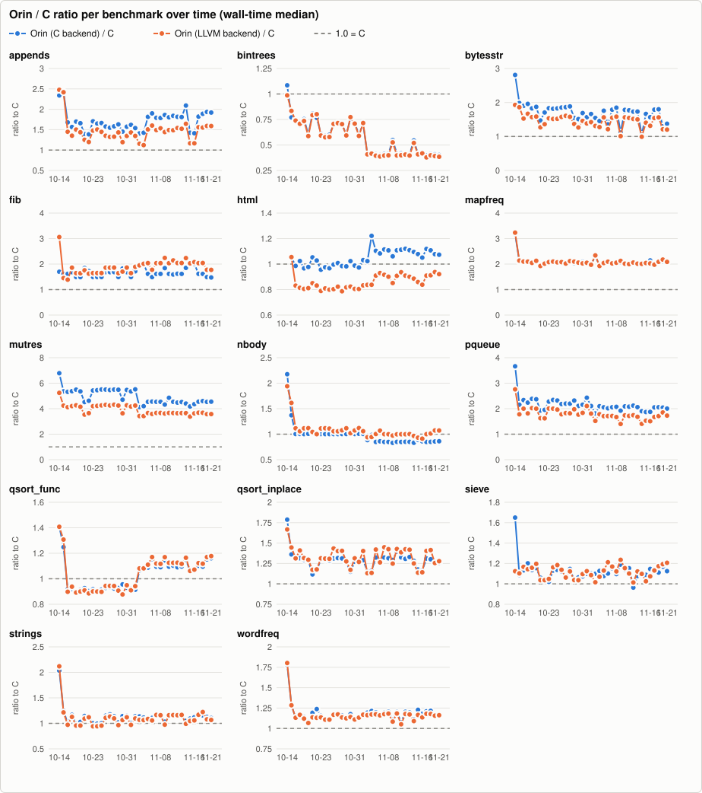

# Orin benchmark history

Written by `.github/workflows/bench.yml` (nightly and manual runs on `main`); one JSON file per run in [`history/`](history/), charts rendered by `tooling/benchmarks` (`bench-report render`, no external services). The same data as a stand-alone page: [`report.html`](report.html). Metrics and methodology: `docs/benchmarks.md` on `main`. Do not edit this branch by hand.

43 runs, 2026-10-14 to 2026-11-27. Latest: [`7635a6de4b`](https://github.com/HenrySchwerdt/orin/commit/7635a6de4ba00d5f68f1c6355860428eaad22201).

Instruction counts are the regression metric: they are deterministic for single-threaded programs, while wall time on a shared runner moves by 10-25 % between identical binaries.

## Latest run

Commit `7635a6de4b` (main), 2026-11-27T13:44:04Z. Machine: AMD EPYC 9V74 80-Core Processor, 4 cores, 15.6 GiB, Linux-7.0.0-1020-azure-x86_64-with-glibc2.43. Runs per cell: 5 (median after one warm-up).

Tool versions

- cc: `cc (Ubuntu 15.2.0-16ubuntu1) 15.2.0`
- clang: `Ubuntu clang version 21.1.8 (6ubuntu1)`
- go: `go version go1.24.13 linux/amd64`
- java: `openjdk version "21.0.13" 2026-10-20 LTS`
- python: `3.14.4`
- rustc: `rustc 1.100.0 (0ef1bc386 2026-11-09)`
- valgrind: `valgrind-3.26.0`

### Wall time, seconds (median; min-max)

| benchmark | Orin (C backend) | Orin (LLVM backend) | C | Go | Java | Rust |
|---|---:|---:|---:|---:|---:|---:|
| appends | 0.009 (0.009-0.009) | 0.007 (0.007-0.008) | 0.005 (0.005-0.005) | 0.013 (0.012-0.015) | 0.069 (0.067-0.093) | 0.004 (0.004-0.004) |
| bintrees | 0.425 (0.424-0.428) | 0.407 (0.404-0.410) | 1.042 (1.040-1.046) | 1.237 (1.229-1.252) | 0.350 (0.349-0.354) | 1.233 (1.230-1.241) |
| bytesstr | 0.041 (0.040-0.041) | 0.035 (0.035-0.036) | 0.023 (0.022-0.023) | 0.010 (0.009-0.015) | 0.094 (0.093-0.099) | 0.042 (0.038-0.043) |
| fib | 0.278 (0.278-0.278) | 0.351 (0.351-0.353) | 0.172 (0.172-0.174) | 0.662 (0.660-0.666) | 0.404 (0.400-0.417) | 0.350 (0.350-0.351) |
| html | 0.158 (0.156-0.159) | 0.128 (0.126-0.130) | 0.143 (0.143-0.145) | 0.238 (0.233-0.243) | n/a | n/a |
| html_hand | 0.129 (0.128-0.130) | 0.097 (0.093-0.097) | n/a | n/a | n/a | n/a |
| http_parse | 0.120 (0.120-0.124) | 0.104 (0.104-0.105) | n/a | n/a | n/a | n/a |
| mapfreq | 0.161 (0.160-0.162) | 0.160 (0.159-0.162) | 0.076 (0.075-0.076) | 0.114 (0.113-0.114) | n/a | n/a |
| mutres | 0.185 (0.185-0.189) | 0.150 (0.150-0.150) | 0.041 (0.041-0.041) | 0.047 (0.046-0.047) | 0.084 (0.083-0.093) | 0.041 (0.041-0.043) |
| nbody | 0.070 (0.070-0.070) | 0.084 (0.084-0.084) | 0.083 (0.083-0.083) | 0.093 (0.092-0.094) | n/a | n/a |
| pqueue | 0.160 (0.159-0.163) | 0.132 (0.131-0.139) | 0.079 (0.078-0.079) | 0.213 (0.210-0.216) | 0.254 (0.240-0.265) | 0.097 (0.096-0.097) |
| qsort_func | 0.226 (0.224-0.227) | 0.231 (0.231-0.232) | 0.207 (0.207-0.207) | 0.418 (0.411-0.441) | n/a | n/a |
| qsort_inplace | 0.127 (0.124-0.130) | 0.136 (0.135-0.138) | 0.096 (0.096-0.097) | 0.141 (0.130-0.144) | n/a | n/a |
| sieve | 0.117 (0.114-0.118) | 0.121 (0.119-0.123) | 0.105 (0.103-0.107) | 0.436 (0.396-0.492) | 0.165 (0.163-0.168) | 0.110 (0.109-0.112) |
| sortedmap | 0.264 (0.263-0.266) | 0.275 (0.274-0.277) | n/a | n/a | n/a | n/a |
| streams | 0.125 (0.125-0.126) | 0.124 (0.123-0.124) | n/a | n/a | n/a | n/a |
| strings | 0.081 (0.081-0.082) | 0.079 (0.079-0.080) | 0.070 (0.069-0.071) | 0.075 (0.072-0.084) | 0.234 (0.230-0.247) | 0.032 (0.031-0.032) |
| tasks | 4.214 (4.155-4.377) | 4.100 (4.058-4.165) | n/a | n/a | n/a | n/a |
| url | 0.376 (0.373-0.390) | 0.330 (0.322-0.346) | n/a | n/a | n/a | n/a |
| wordfreq | 0.132 (0.130-0.133) | 0.125 (0.124-0.126) | 0.107 (0.106-0.109) | 0.121 (0.120-0.123) | n/a | n/a |

### Ratio to C (wall-time median; lower is better, 1.00x = as fast as C)

| benchmark | Orin C/C | Orin LLVM/C | Go/C | Java/C | Rust/C |
|---|---:|---:|---:|---:|---:|
| appends | 1.89x | 1.51x | 2.65x | 14.06x | 0.85x |
| bintrees | 0.41x | 0.39x | 1.19x | 0.34x | 1.18x |
| bytesstr | 1.81x | 1.57x | 0.42x | 4.16x | 1.88x |
| fib | 1.62x | 2.04x | 3.85x | 2.35x | 2.03x |
| html | 1.10x | 0.90x | 1.67x | n/a | n/a |
| html_hand | n/a | n/a | n/a | n/a | n/a |
| http_parse | n/a | n/a | n/a | n/a | n/a |
| mapfreq | 2.13x | 2.12x | 1.51x | n/a | n/a |
| mutres | 4.54x | 3.67x | 1.15x | 2.06x | 1.00x |
| nbody | 0.85x | 1.02x | 1.12x | n/a | n/a |
| pqueue | 2.03x | 1.68x | 2.71x | 3.23x | 1.23x |
| qsort_func | 1.09x | 1.12x | 2.02x | n/a | n/a |
| qsort_inplace | 1.32x | 1.41x | 1.46x | n/a | n/a |
| sieve | 1.12x | 1.16x | 4.17x | 1.58x | 1.05x |
| sortedmap | n/a | n/a | n/a | n/a | n/a |
| streams | n/a | n/a | n/a | n/a | n/a |
| strings | 1.16x | 1.13x | 1.06x | 3.34x | 0.45x |
| tasks | n/a | n/a | n/a | n/a | n/a |
| url | n/a | n/a | n/a | n/a | n/a |
| wordfreq | 1.23x | 1.16x | 1.12x | n/a | n/a |

### CPU time (user + sys, median s) and peak RSS (MiB)

| benchmark | orin CPU | llvm CPU | c CPU | go CPU | java CPU | rust CPU | orin RSS | llvm RSS | c RSS | go RSS | java RSS | rust RSS |
|---|---:|---:|---:|---:|---:|---:|---:|---:|---:|---:|---:|---:|
| appends | 0.009 | 0.007 | 0.005 | 0.019 | 0.109 | 0.004 | 4.8 | 5.0 | 4.8 | 7.9 | 47.8 | 5.2 |
| bintrees | 0.425 | 0.406 | 1.042 | 2.631 | 0.402 | 1.233 | 17.7 | 17.8 | 9.6 | 12.1 | 301.2 | 10.0 |
| bytesstr | 0.041 | 0.035 | 0.022 | 0.014 | 0.115 | 0.042 | 11.6 | 11.8 | 11.6 | 6.3 | 103.3 | 5.0 |
| fib | 0.278 | 0.351 | 0.172 | 0.665 | 0.416 | 0.349 | 1.6 | 1.8 | 1.5 | 1.8 | 38.8 | 2.1 |
| html | 0.158 | 0.128 | 0.143 | 0.323 | n/a | n/a | 4.0 | 4.1 | 2.1 | 7.7 | n/a | n/a |
| html_hand | 0.129 | 0.097 | n/a | n/a | n/a | n/a | 2.7 | 2.8 | n/a | n/a | n/a | n/a |
| http_parse | 0.120 | 0.104 | n/a | n/a | n/a | n/a | 1.8 | 1.9 | n/a | n/a | n/a | n/a |
| mapfreq | 0.161 | 0.160 | 0.075 | 0.127 | n/a | n/a | 11.2 | 11.3 | 5.0 | 7.5 | n/a | n/a |
| mutres | 0.185 | 0.150 | 0.041 | 0.047 | 0.115 | 0.041 | 1.6 | 1.8 | 1.5 | 1.8 | 39.1 | 2.0 |
| nbody | 0.070 | 0.084 | 0.082 | 0.093 | n/a | n/a | 1.9 | 1.9 | 1.8 | 1.7 | n/a | n/a |
| pqueue | 0.159 | 0.132 | 0.078 | 0.230 | 0.325 | 0.097 | 6.3 | 6.5 | 4.8 | 14.9 | 62.1 | 5.2 |
| qsort_func | 0.226 | 0.231 | 0.206 | 0.531 | n/a | n/a | 36.4 | 36.6 | 22.0 | 42.0 | n/a | n/a |
| qsort_inplace | 0.127 | 0.136 | 0.096 | 0.178 | n/a | n/a | 17.0 | 17.1 | 16.8 | 28.6 | n/a | n/a |
| sieve | 0.117 | 0.121 | 0.104 | 0.734 | 0.190 | 0.109 | 78.0 | 78.2 | 77.7 | 275.0 | 116.0 | 78.5 |
| sortedmap | 0.264 | 0.275 | n/a | n/a | n/a | n/a | 11.3 | 11.4 | n/a | n/a | n/a | n/a |
| streams | 0.125 | 0.123 | n/a | n/a | n/a | n/a | 39.9 | 40.1 | n/a | n/a | n/a | n/a |
| strings | 0.081 | 0.079 | 0.070 | 0.096 | 0.450 | 0.031 | 46.3 | 46.5 | 34.8 | 21.5 | 139.2 | 20.1 |
| tasks | 5.118 | 4.860 | n/a | n/a | n/a | n/a | 14.1 | 14.4 | n/a | n/a | n/a | n/a |
| url | 0.375 | 0.330 | n/a | n/a | n/a | n/a | 6.5 | 6.7 | n/a | n/a | n/a | n/a |
| wordfreq | 0.132 | 0.124 | 0.107 | 0.124 | n/a | n/a | 2.3 | 2.5 | 1.9 | 6.5 | n/a | n/a |

### Executed instructions (valgrind; the regression metric)

| benchmark | Orin C | Orin LLVM | C | Orin C/C | Orin LLVM/C | note |
|---|---:|---:|---:|---:|---:|---|
| appends | 60,396,257 | 43,975,557 | 18,927,373 | 3.19x | 2.32x |  |
| bintrees | 4,351,239,711 | 4,313,425,955 | 11,630,513,487 | 0.37x | 0.37x |  |
| bytesstr | 349,643,257 | 259,442,315 | 103,926,179 | 3.36x | 2.50x |  |
| fib | 3,200,255,443 | 2,342,472,329 | 2,780,168,025 | 1.15x | 0.84x |  |
| html | 1,578,539,387 | 1,388,947,363 | 1,521,579,597 | 1.04x | 0.91x |  |
| html_hand | 1,201,366,940 | 989,088,178 | n/a | n/a | n/a |  |
| http_parse | 1,507,219,853 | 1,363,867,923 | n/a | n/a | n/a |  |
| mapfreq | 1,014,961,827 | 996,989,254 | 682,001,909 | 1.49x | 1.46x |  |
| mutres | 2,470,217,982 | 2,030,196,321 | 267,648,838 | 9.23x | 7.59x |  |
| nbody | 464,252,863 | 768,198,854 | 386,175,662 | 1.20x | 1.99x |  |
| pqueue | 1,383,384,499 | 1,325,195,828 | 359,470,793 | 3.85x | 3.69x |  |
| qsort_func | 1,317,510,895 | 1,279,283,102 | 1,064,640,591 | 1.24x | 1.20x |  |
| qsort_inplace | 622,537,034 | 521,083,733 | 275,674,745 | 2.26x | 1.89x |  |
| sieve | 390,345,736 | 451,732,211 | 161,705,036 | 2.41x | 2.79x |  |
| sortedmap | 1,335,062,289 | 1,343,621,844 | n/a | n/a | n/a |  |
| streams | 1,173,822,977 | 1,173,802,851 | n/a | n/a | n/a |  |
| strings | 653,658,157 | 580,559,129 | 734,241,512 | 0.89x | 0.79x |  |
| tasks | n/a | n/a | n/a | n/a | n/a | llvm skipped: multi-threaded (20,000 tasks, channels): valgrind serialises threads, so the count would include scheduler waits; orin skipped: multi-threaded (20,000 tasks, channels): valgrind serialises threads, so the count would include scheduler waits |
| url | 4,584,662,794 | 4,368,675,430 | n/a | n/a | n/a |  |
| wordfreq | 755,666,515 | 708,712,081 | 860,830,646 | 0.88x | 0.82x |  |

### Parallel speedup (std:task; worker threads = first argument of the program)

| benchmark | threads | wall s (min-max) | CPU s (user+sys) | speedup | efficiency | CPU vs 1 thread | output |
|---|---:|---:|---:|---:|---:|---:|---|
| parallel_collatz | 1 | 0.540 (0.537-0.540) | 0.540 | 1.00x | 100 % | 1.00x | same |
| parallel_collatz | 2 | 0.316 (0.316-0.317) | 0.573 | 1.71x | 85 % | 1.06x | same |
| parallel_collatz | 4 | 0.207 (0.204-0.207) | 0.697 | 2.61x | 65 % | 1.29x | same |
| streams_parallel | 1 | 0.529 (0.529-0.531) | 0.529 | 1.00x | 100 % | 1.00x | same |
| streams_parallel | 2 | 0.278 (0.278-0.279) | 0.532 | 1.90x | 95 % | 1.01x | same |
| streams_parallel | 4 | 0.174 (0.173-0.174) | 0.620 | 3.05x | 76 % | 1.17x | same |

Speedup = wall(1 thread) / wall(n); efficiency = speedup / n. CPU time that grows with n is overhead or oversubscription (more threads than free cores).

### Self-compile (orin2 compiles compiler/main.or)

| wall s (min-max) | CPU s | peak RSS MiB | instructions | output identical to stage2.c |
|---:|---:|---:|---:|---|
| 2.648 (2.633-2.658) | 4.766 | 394.8 | 28,542,429,772 | yes |

## All runs

| date | commit | ref | self-compile instructions | self-compile wall s | file |
|---|---|---|---:|---:|---|
| 2026-11-27T13:44:04Z | `7635a6de4b` | main | 28,542,429,772 | 2.648 | [json](history/2026-11-27-7635a6de4ba0.json) |
| 2026-11-26T13:46:49Z | `7635a6de4b` | main | 28,541,958,585 | 2.661 | [json](history/2026-11-26-7635a6de4ba0.json) |
| 2026-11-25T14:07:56Z | `7635a6de4b` | main | 28,542,896,819 | 2.634 | [json](history/2026-11-25-7635a6de4ba0.json) |
| 2026-11-24T14:46:25Z | `7635a6de4b` | main | 28,543,458,173 | 2.596 | [json](history/2026-11-24-7635a6de4ba0.json) |
| 2026-11-23T14:16:00Z | `7635a6de4b` | main | 28,541,497,326 | 2.347 | [json](history/2026-11-23-7635a6de4ba0.json) |
| 2026-11-22T12:32:41Z | `7635a6de4b` | main | 28,542,696,623 | 2.347 | [json](history/2026-11-22-7635a6de4ba0.json) |
| 2026-11-21T12:19:24Z | `7635a6de4b` | main | 28,542,569,621 | 2.450 | [json](history/2026-11-21-7635a6de4ba0.json) |
| 2026-11-20T12:44:53Z | `7635a6de4b` | main | 28,541,523,709 | 2.611 | [json](history/2026-11-20-7635a6de4ba0.json) |
| 2026-11-18T12:53:40Z | `7635a6de4b` | main | 28,542,480,299 | 2.742 | [json](history/2026-11-18-7635a6de4ba0.json) |
| 2026-11-17T12:57:26Z | `7635a6de4b` | main | 28,543,095,342 | 2.282 | [json](history/2026-11-17-7635a6de4ba0.json) |
| 2026-11-16T12:34:51Z | `7635a6de4b` | main | 28,541,439,702 | 1.930 | [json](history/2026-11-16-7635a6de4ba0.json) |
| 2026-11-15T11:54:27Z | `7635a6de4b` | main | 28,542,663,271 | 1.858 | [json](history/2026-11-15-7635a6de4ba0.json) |
| 2026-11-14T11:29:07Z | `7635a6de4b` | main | 28,541,943,893 | 2.378 | [json](history/2026-11-14-7635a6de4ba0.json) |
| 2026-11-13T12:02:42Z | `7635a6de4b` | main | 28,542,382,986 | 2.218 | [json](history/2026-11-13-7635a6de4ba0.json) |
| 2026-11-12T12:22:16Z | `7635a6de4b` | main | 28,542,960,948 | 2.473 | [json](history/2026-11-12-7635a6de4ba0.json) |
| 2026-11-11T11:53:47Z | `7635a6de4b` | main | 28,542,808,219 | 2.327 | [json](history/2026-11-11-7635a6de4ba0.json) |
| 2026-11-10T12:19:35Z | `7635a6de4b` | main | 28,542,948,040 | 2.345 | [json](history/2026-11-10-7635a6de4ba0.json) |
| 2026-11-09T12:46:20Z | `7635a6de4b` | main | 28,542,360,770 | 2.228 | [json](history/2026-11-09-7635a6de4ba0.json) |
| 2026-11-08T11:13:42Z | `7635a6de4b` | main | 28,542,100,863 | 2.306 | [json](history/2026-11-08-7635a6de4ba0.json) |
| 2026-11-07T11:05:37Z | `7635a6de4b` | main | 28,542,838,708 | 2.349 | [json](history/2026-11-07-7635a6de4ba0.json) |
| 2026-11-06T12:14:12Z | `7635a6de4b` | main | 28,542,494,981 | 2.629 | [json](history/2026-11-06-7635a6de4ba0.json) |
| 2026-11-05T12:03:31Z | `7635a6de4b` | main | 28,542,603,064 | 2.304 | [json](history/2026-11-05-7635a6de4ba0.json) |
| 2026-11-04T12:01:20Z | `7635a6de4b` | main | 28,542,780,461 | 2.352 | [json](history/2026-11-04-7635a6de4ba0.json) |
| 2026-11-03T11:46:50Z | `7635a6de4b` | main | 28,542,833,519 | 1.976 | [json](history/2026-11-03-7635a6de4ba0.json) |
| 2026-11-02T12:12:00Z | `7635a6de4b` | main | 28,930,351,842 | 2.587 | [json](history/2026-11-02-7635a6de4ba0.json) |
| 2026-11-01T11:15:45Z | `7635a6de4b` | main | 28,919,490,355 | 2.724 | [json](history/2026-11-01-7635a6de4ba0.json) |
| 2026-10-31T10:26:16Z | `7635a6de4b` | main | 28,907,840,339 | 2.912 | [json](history/2026-10-31-7635a6de4ba0.json) |
| 2026-10-30T10:52:47Z | `7635a6de4b` | main | 28,929,137,893 | 2.245 | [json](history/2026-10-30-7635a6de4ba0.json) |
| 2026-10-29T10:57:02Z | `7635a6de4b` | main | 28,928,714,860 | 2.725 | [json](history/2026-10-29-7635a6de4ba0.json) |
| 2026-10-28T10:34:30Z | `7635a6de4b` | main | 28,927,700,571 | 2.775 | [json](history/2026-10-28-7635a6de4ba0.json) |
| 2026-10-27T09:54:38Z | `7635a6de4b` | main | 28,929,325,676 | 2.422 | [json](history/2026-10-27-7635a6de4ba0.json) |
| 2026-10-26T09:51:57Z | `7635a6de4b` | main | 28,898,057,347 | 2.328 | [json](history/2026-10-26-7635a6de4ba0.json) |
| 2026-10-25T09:10:57Z | `7635a6de4b` | main | 28,925,568,576 | 2.594 | [json](history/2026-10-25-7635a6de4ba0.json) |
| 2026-10-24T08:51:56Z | `7635a6de4b` | main | 28,924,241,295 | 2.708 | [json](history/2026-10-24-7635a6de4ba0.json) |
| 2026-10-23T09:21:38Z | `7635a6de4b` | main | 28,928,848,177 | 2.577 | [json](history/2026-10-23-7635a6de4ba0.json) |
| 2026-10-22T09:18:06Z | `7635a6de4b` | main | 28,927,908,288 | 1.939 | [json](history/2026-10-22-7635a6de4ba0.json) |
| 2026-10-21T09:16:22Z | `7635a6de4b` | main | 28,929,128,127 | 2.146 | [json](history/2026-10-21-7635a6de4ba0.json) |
| 2026-10-20T09:21:19Z | `7635a6de4b` | main | 28,924,224,488 | 2.688 | [json](history/2026-10-20-7635a6de4ba0.json) |
| 2026-10-19T09:49:07Z | `7635a6de4b` | main | 28,920,330,777 | 2.632 | [json](history/2026-10-19-7635a6de4ba0.json) |
| 2026-10-18T08:43:59Z | `7635a6de4b` | main | 28,927,449,240 | 2.360 | [json](history/2026-10-18-7635a6de4ba0.json) |
| 2026-10-17T08:29:19Z | `d0a17a9682` | main | 26,314,861,202 | 2.370 | [json](history/2026-10-17-d0a17a968285.json) |
| 2026-10-16T08:55:17Z | `9f83f16af4` | main | 24,496,056,957 | 2.438 | [json](history/2026-10-16-9f83f16af402.json) |
| 2026-10-14T17:32:27Z | `f837889af7` | main | 35,729,157,194 | 3.937 | [json](history/2026-10-14-f837889af7a9.json) |
