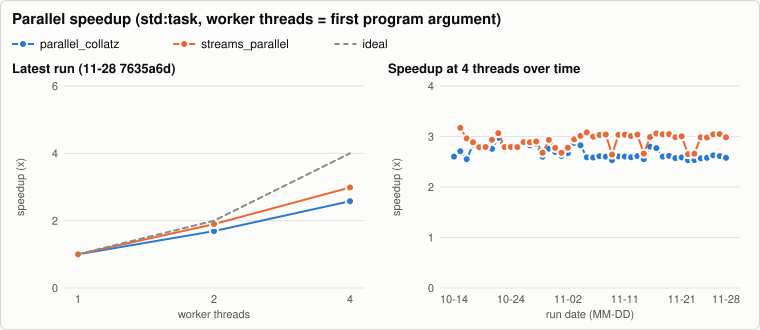

# Orin benchmark history

Written by `.github/workflows/bench.yml` (nightly and manual runs on `main`); one JSON file per run in [`history/`](history/), charts rendered by `tooling/benchmarks` (`bench-report render`, no external services). The same data as a stand-alone page: [`report.html`](report.html). Metrics and methodology: `docs/benchmarks.md` on `main`. Do not edit this branch by hand.

44 runs, 2026-10-14 to 2026-11-28. Latest: [`7635a6de4b`](https://github.com/HenrySchwerdt/orin/commit/7635a6de4ba00d5f68f1c6355860428eaad22201).

Instruction counts are the regression metric: they are deterministic for single-threaded programs, while wall time on a shared runner moves by 10-25 % between identical binaries.

## Latest run

Commit `7635a6de4b` (main), 2026-11-28T12:56:12Z. Machine: AMD EPYC 7763 64-Core Processor, 4 cores, 15.6 GiB, Linux-7.0.0-1020-azure-x86_64-with-glibc2.43. Runs per cell: 5 (median after one warm-up).

Tool versions

- cc: `cc (Ubuntu 15.2.0-16ubuntu1) 15.2.0`
- clang: `Ubuntu clang version 21.1.8 (6ubuntu1)`
- go: `go version go1.24.13 linux/amd64`
- java: `openjdk version "21.0.13.1" 2026-11-17 LTS`
- python: `3.14.4`
- rustc: `rustc 1.100.1 (20ddd0171 2026-11-25)`
- valgrind: `valgrind-3.26.0`

### Wall time, seconds (median; min-max)

| benchmark | Orin (C backend) | Orin (LLVM backend) | C | Go | Java | Rust |
|---|---:|---:|---:|---:|---:|---:|
| appends | 0.009 (0.009-0.009) | 0.008 (0.008-0.008) | 0.005 (0.005-0.005) | 0.012 (0.011-0.014) | 0.072 (0.068-0.078) | 0.005 (0.005-0.005) |
| bintrees | 0.417 (0.413-0.417) | 0.394 (0.391-0.408) | 1.037 (1.023-1.098) | 1.281 (1.277-1.332) | 0.330 (0.326-0.343) | 1.169 (1.167-1.189) |
| bytesstr | 0.037 (0.037-0.038) | 0.033 (0.033-0.034) | 0.028 (0.027-0.028) | 0.010 (0.009-0.012) | 0.105 (0.095-0.112) | 0.037 (0.037-0.038) |
| fib | 0.264 (0.263-0.285) | 0.314 (0.314-0.314) | 0.177 (0.176-0.177) | 0.588 (0.573-0.605) | 0.435 (0.416-0.443) | 0.314 (0.314-0.314) |
| html | 0.162 (0.161-0.163) | 0.141 (0.138-0.142) | 0.150 (0.149-0.152) | 0.239 (0.234-0.244) | n/a | n/a |
| html_hand | 0.128 (0.128-0.130) | 0.101 (0.100-0.102) | n/a | n/a | n/a | n/a |
| http_parse | 0.126 (0.125-0.131) | 0.113 (0.112-0.114) | n/a | n/a | n/a | n/a |
| mapfreq | 0.162 (0.161-0.170) | 0.161 (0.161-0.163) | 0.077 (0.075-0.079) | 0.118 (0.116-0.118) | n/a | n/a |
| mutres | 0.170 (0.170-0.172) | 0.135 (0.135-0.135) | 0.037 (0.037-0.039) | 0.045 (0.044-0.045) | 0.085 (0.080-0.085) | 0.038 (0.037-0.038) |
| nbody | 0.063 (0.063-0.064) | 0.079 (0.079-0.080) | 0.073 (0.073-0.074) | 0.088 (0.087-0.088) | n/a | n/a |
| pqueue | 0.145 (0.145-0.149) | 0.126 (0.125-0.129) | 0.073 (0.073-0.074) | 0.199 (0.195-0.204) | 0.238 (0.235-0.251) | 0.090 (0.089-0.090) |
| qsort_func | 0.214 (0.214-0.215) | 0.215 (0.215-0.220) | 0.183 (0.183-0.185) | 0.391 (0.381-0.424) | n/a | n/a |
| qsort_inplace | 0.109 (0.109-0.109) | 0.110 (0.109-0.110) | 0.086 (0.086-0.087) | 0.113 (0.103-0.125) | n/a | n/a |
| sieve | 0.113 (0.111-0.114) | 0.120 (0.118-0.122) | 0.105 (0.104-0.105) | 0.264 (0.228-0.331) | 0.171 (0.166-0.172) | 0.107 (0.105-0.110) |
| sortedmap | 0.247 (0.246-0.252) | 0.257 (0.257-0.264) | n/a | n/a | n/a | n/a |
| streams | 0.124 (0.123-0.125) | 0.108 (0.107-0.109) | n/a | n/a | n/a | n/a |
| strings | 0.078 (0.077-0.078) | 0.076 (0.075-0.086) | 0.071 (0.070-0.073) | 0.083 (0.068-0.085) | 0.235 (0.231-0.242) | 0.031 (0.030-0.031) |
| tasks | 4.000 (3.930-4.178) | 3.947 (3.870-3.985) | n/a | n/a | n/a | n/a |
| url | 0.357 (0.353-0.360) | 0.327 (0.324-0.330) | n/a | n/a | n/a | n/a |
| wordfreq | 0.127 (0.127-0.129) | 0.125 (0.124-0.126) | 0.106 (0.106-0.111) | 0.117 (0.117-0.119) | n/a | n/a |

### Ratio to C (wall-time median; lower is better, 1.00x = as fast as C)

| benchmark | Orin C/C | Orin LLVM/C | Go/C | Java/C | Rust/C |
|---|---:|---:|---:|---:|---:|
| appends | 1.91x | 1.59x | 2.45x | 15.13x | 0.95x |
| bintrees | 0.40x | 0.38x | 1.24x | 0.32x | 1.13x |
| bytesstr | 1.33x | 1.19x | 0.34x | 3.77x | 1.33x |
| fib | 1.49x | 1.78x | 3.33x | 2.46x | 1.78x |
| html | 1.08x | 0.94x | 1.59x | n/a | n/a |
| html_hand | n/a | n/a | n/a | n/a | n/a |
| http_parse | n/a | n/a | n/a | n/a | n/a |
| mapfreq | 2.12x | 2.11x | 1.54x | n/a | n/a |
| mutres | 4.55x | 3.60x | 1.19x | 2.27x | 1.01x |
| nbody | 0.86x | 1.07x | 1.19x | n/a | n/a |
| pqueue | 1.99x | 1.72x | 2.72x | 3.26x | 1.23x |
| qsort_func | 1.17x | 1.17x | 2.13x | n/a | n/a |
| qsort_inplace | 1.26x | 1.27x | 1.31x | n/a | n/a |
| sieve | 1.08x | 1.15x | 2.52x | 1.63x | 1.02x |
| sortedmap | n/a | n/a | n/a | n/a | n/a |
| streams | n/a | n/a | n/a | n/a | n/a |
| strings | 1.10x | 1.07x | 1.17x | 3.32x | 0.43x |
| tasks | n/a | n/a | n/a | n/a | n/a |
| url | n/a | n/a | n/a | n/a | n/a |
| wordfreq | 1.20x | 1.18x | 1.10x | n/a | n/a |

### CPU time (user + sys, median s) and peak RSS (MiB)

| benchmark | orin CPU | llvm CPU | c CPU | go CPU | java CPU | rust CPU | orin RSS | llvm RSS | c RSS | go RSS | java RSS | rust RSS |
|---|---:|---:|---:|---:|---:|---:|---:|---:|---:|---:|---:|---:|
| appends | 0.009 | 0.007 | 0.005 | 0.017 | 0.107 | 0.004 | 4.8 | 5.0 | 4.8 | 8.0 | 48.0 | 5.2 |
| bintrees | 0.417 | 0.394 | 1.036 | 2.793 | 0.386 | 1.168 | 17.6 | 17.9 | 9.5 | 12.9 | 301.1 | 10.1 |
| bytesstr | 0.037 | 0.033 | 0.028 | 0.014 | 0.118 | 0.037 | 11.7 | 11.8 | 11.6 | 6.2 | 104.5 | 5.1 |
| fib | 0.264 | 0.314 | 0.176 | 0.590 | 0.446 | 0.313 | 1.6 | 1.8 | 1.5 | 1.7 | 38.7 | 2.1 |
| html | 0.162 | 0.140 | 0.150 | 0.323 | n/a | n/a | 3.9 | 4.2 | 2.1 | 7.5 | n/a | n/a |
| html_hand | 0.128 | 0.101 | n/a | n/a | n/a | n/a | 2.6 | 2.9 | n/a | n/a | n/a | n/a |
| http_parse | 0.125 | 0.112 | n/a | n/a | n/a | n/a | 1.8 | 1.9 | n/a | n/a | n/a | n/a |
| mapfreq | 0.162 | 0.161 | 0.076 | 0.132 | n/a | n/a | 11.2 | 11.4 | 5.0 | 7.1 | n/a | n/a |
| mutres | 0.170 | 0.134 | 0.037 | 0.045 | 0.113 | 0.037 | 1.6 | 1.8 | 1.5 | 1.7 | 39.1 | 2.2 |
| nbody | 0.063 | 0.078 | 0.073 | 0.088 | n/a | n/a | 1.8 | 1.8 | 1.8 | 1.7 | n/a | n/a |
| pqueue | 0.145 | 0.125 | 0.073 | 0.211 | 0.309 | 0.089 | 6.3 | 6.4 | 4.8 | 14.6 | 62.1 | 5.2 |
| qsort_func | 0.214 | 0.215 | 0.183 | 0.497 | n/a | n/a | 36.4 | 36.6 | 22.0 | 43.8 | n/a | n/a |
| qsort_inplace | 0.109 | 0.109 | 0.086 | 0.138 | n/a | n/a | 17.0 | 17.1 | 16.8 | 29.7 | n/a | n/a |
| sieve | 0.113 | 0.120 | 0.104 | 0.402 | 0.198 | 0.107 | 78.0 | 78.2 | 77.7 | 231.7 | 116.0 | 78.5 |
| sortedmap | 0.247 | 0.256 | n/a | n/a | n/a | n/a | 11.3 | 11.5 | n/a | n/a | n/a | n/a |
| streams | 0.124 | 0.107 | n/a | n/a | n/a | n/a | 39.8 | 40.1 | n/a | n/a | n/a | n/a |
| strings | 0.078 | 0.075 | 0.071 | 0.113 | 0.461 | 0.030 | 46.3 | 46.5 | 34.8 | 23.5 | 139.2 | 20.1 |
| tasks | 4.778 | 4.637 | n/a | n/a | n/a | n/a | 14.1 | 14.4 | n/a | n/a | n/a | n/a |
| url | 0.357 | 0.326 | n/a | n/a | n/a | n/a | 6.6 | 6.8 | n/a | n/a | n/a | n/a |
| wordfreq | 0.127 | 0.125 | 0.106 | 0.120 | n/a | n/a | 2.4 | 2.5 | 1.9 | 6.6 | n/a | n/a |

### Executed instructions (valgrind; the regression metric)

| benchmark | Orin C | Orin LLVM | C | Orin C/C | Orin LLVM/C | note |
|---|---:|---:|---:|---:|---:|---|
| appends | 60,396,246 | 43,975,546 | 18,927,362 | 3.19x | 2.32x |  |
| bintrees | 4,351,239,717 | 4,313,425,961 | 11,630,513,498 | 0.37x | 0.37x |  |
| bytesstr | 349,643,263 | 259,442,321 | 103,926,190 | 3.36x | 2.50x |  |
| fib | 3,200,255,443 | 2,342,472,329 | 2,780,168,020 | 1.15x | 0.84x |  |
| html | 1,578,539,376 | 1,388,947,352 | 1,521,579,597 | 1.04x | 0.91x |  |
| html_hand | 1,201,366,940 | 989,088,178 | n/a | n/a | n/a |  |
| http_parse | 1,507,219,848 | 1,363,867,918 | n/a | n/a | n/a |  |
| mapfreq | 1,014,961,816 | 996,989,243 | 682,001,898 | 1.49x | 1.46x |  |
| mutres | 2,470,217,982 | 2,030,196,321 | 267,648,838 | 9.23x | 7.59x |  |
| nbody | 464,252,874 | 768,198,865 | 386,175,662 | 1.20x | 1.99x |  |
| pqueue | 1,383,384,499 | 1,325,195,828 | 359,470,793 | 3.85x | 3.69x |  |
| qsort_func | 1,317,510,890 | 1,279,283,097 | 1,064,640,580 | 1.24x | 1.20x |  |
| qsort_inplace | 622,537,034 | 521,083,733 | 275,674,745 | 2.26x | 1.89x |  |
| sieve | 390,345,747 | 451,732,222 | 161,705,036 | 2.41x | 2.79x |  |
| sortedmap | 1,335,062,289 | 1,343,621,844 | n/a | n/a | n/a |  |
| streams | 1,173,822,966 | 1,173,802,840 | n/a | n/a | n/a |  |
| strings | 653,658,146 | 580,559,118 | 734,241,501 | 0.89x | 0.79x |  |
| tasks | n/a | n/a | n/a | n/a | n/a | llvm skipped: multi-threaded (20,000 tasks, channels): valgrind serialises threads, so the count would include scheduler waits; orin skipped: multi-threaded (20,000 tasks, channels): valgrind serialises threads, so the count would include scheduler waits |
| url | 4,584,662,794 | 4,368,675,430 | n/a | n/a | n/a |  |
| wordfreq | 755,666,521 | 708,712,087 | 860,830,657 | 0.88x | 0.82x |  |

### Parallel speedup (std:task; worker threads = first argument of the program)

| benchmark | threads | wall s (min-max) | CPU s (user+sys) | speedup | efficiency | CPU vs 1 thread | output |
|---|---:|---:|---:|---:|---:|---:|---|
| parallel_collatz | 1 | 0.495 (0.494-0.495) | 0.494 | 1.00x | 100 % | 1.00x | same |
| parallel_collatz | 2 | 0.293 (0.292-0.293) | 0.529 | 1.69x | 85 % | 1.07x | same |
| parallel_collatz | 4 | 0.192 (0.191-0.197) | 0.644 | 2.58x | 64 % | 1.30x | same |
| streams_parallel | 1 | 0.489 (0.489-0.489) | 0.489 | 1.00x | 100 % | 1.00x | same |
| streams_parallel | 2 | 0.258 (0.257-0.258) | 0.491 | 1.90x | 95 % | 1.00x | same |
| streams_parallel | 4 | 0.164 (0.164-0.165) | 0.581 | 2.98x | 75 % | 1.19x | same |

Speedup = wall(1 thread) / wall(n); efficiency = speedup / n. CPU time that grows with n is overhead or oversubscription (more threads than free cores).

### Self-compile (orin2 compiles compiler/main.or)

| wall s (min-max) | CPU s | peak RSS MiB | instructions | output identical to stage2.c |
|---:|---:|---:|---:|---|
| 2.570 (2.541-2.622) | 4.687 | 395.3 | 28,543,020,520 | yes |

## All runs

| date | commit | ref | self-compile instructions | self-compile wall s | file |
|---|---|---|---:|---:|---|
| 2026-11-28T12:56:12Z | `7635a6de4b` | main | 28,543,020,520 | 2.570 | [json](history/2026-11-28-7635a6de4ba0.json) |
| 2026-11-27T13:44:04Z | `7635a6de4b` | main | 28,542,429,772 | 2.648 | [json](history/2026-11-27-7635a6de4ba0.json) |
| 2026-11-26T13:46:49Z | `7635a6de4b` | main | 28,541,958,585 | 2.661 | [json](history/2026-11-26-7635a6de4ba0.json) |
| 2026-11-25T14:07:56Z | `7635a6de4b` | main | 28,542,896,819 | 2.634 | [json](history/2026-11-25-7635a6de4ba0.json) |
| 2026-11-24T14:46:25Z | `7635a6de4b` | main | 28,543,458,173 | 2.596 | [json](history/2026-11-24-7635a6de4ba0.json) |
| 2026-11-23T14:16:00Z | `7635a6de4b` | main | 28,541,497,326 | 2.347 | [json](history/2026-11-23-7635a6de4ba0.json) |
| 2026-11-22T12:32:41Z | `7635a6de4b` | main | 28,542,696,623 | 2.347 | [json](history/2026-11-22-7635a6de4ba0.json) |
| 2026-11-21T12:19:24Z | `7635a6de4b` | main | 28,542,569,621 | 2.450 | [json](history/2026-11-21-7635a6de4ba0.json) |
| 2026-11-20T12:44:53Z | `7635a6de4b` | main | 28,541,523,709 | 2.611 | [json](history/2026-11-20-7635a6de4ba0.json) |
| 2026-11-18T12:53:40Z | `7635a6de4b` | main | 28,542,480,299 | 2.742 | [json](history/2026-11-18-7635a6de4ba0.json) |
| 2026-11-17T12:57:26Z | `7635a6de4b` | main | 28,543,095,342 | 2.282 | [json](history/2026-11-17-7635a6de4ba0.json) |
| 2026-11-16T12:34:51Z | `7635a6de4b` | main | 28,541,439,702 | 1.930 | [json](history/2026-11-16-7635a6de4ba0.json) |
| 2026-11-15T11:54:27Z | `7635a6de4b` | main | 28,542,663,271 | 1.858 | [json](history/2026-11-15-7635a6de4ba0.json) |
| 2026-11-14T11:29:07Z | `7635a6de4b` | main | 28,541,943,893 | 2.378 | [json](history/2026-11-14-7635a6de4ba0.json) |
| 2026-11-13T12:02:42Z | `7635a6de4b` | main | 28,542,382,986 | 2.218 | [json](history/2026-11-13-7635a6de4ba0.json) |
| 2026-11-12T12:22:16Z | `7635a6de4b` | main | 28,542,960,948 | 2.473 | [json](history/2026-11-12-7635a6de4ba0.json) |
| 2026-11-11T11:53:47Z | `7635a6de4b` | main | 28,542,808,219 | 2.327 | [json](history/2026-11-11-7635a6de4ba0.json) |
| 2026-11-10T12:19:35Z | `7635a6de4b` | main | 28,542,948,040 | 2.345 | [json](history/2026-11-10-7635a6de4ba0.json) |
| 2026-11-09T12:46:20Z | `7635a6de4b` | main | 28,542,360,770 | 2.228 | [json](history/2026-11-09-7635a6de4ba0.json) |
| 2026-11-08T11:13:42Z | `7635a6de4b` | main | 28,542,100,863 | 2.306 | [json](history/2026-11-08-7635a6de4ba0.json) |
| 2026-11-07T11:05:37Z | `7635a6de4b` | main | 28,542,838,708 | 2.349 | [json](history/2026-11-07-7635a6de4ba0.json) |
| 2026-11-06T12:14:12Z | `7635a6de4b` | main | 28,542,494,981 | 2.629 | [json](history/2026-11-06-7635a6de4ba0.json) |
| 2026-11-05T12:03:31Z | `7635a6de4b` | main | 28,542,603,064 | 2.304 | [json](history/2026-11-05-7635a6de4ba0.json) |
| 2026-11-04T12:01:20Z | `7635a6de4b` | main | 28,542,780,461 | 2.352 | [json](history/2026-11-04-7635a6de4ba0.json) |
| 2026-11-03T11:46:50Z | `7635a6de4b` | main | 28,542,833,519 | 1.976 | [json](history/2026-11-03-7635a6de4ba0.json) |
| 2026-11-02T12:12:00Z | `7635a6de4b` | main | 28,930,351,842 | 2.587 | [json](history/2026-11-02-7635a6de4ba0.json) |
| 2026-11-01T11:15:45Z | `7635a6de4b` | main | 28,919,490,355 | 2.724 | [json](history/2026-11-01-7635a6de4ba0.json) |
| 2026-10-31T10:26:16Z | `7635a6de4b` | main | 28,907,840,339 | 2.912 | [json](history/2026-10-31-7635a6de4ba0.json) |
| 2026-10-30T10:52:47Z | `7635a6de4b` | main | 28,929,137,893 | 2.245 | [json](history/2026-10-30-7635a6de4ba0.json) |
| 2026-10-29T10:57:02Z | `7635a6de4b` | main | 28,928,714,860 | 2.725 | [json](history/2026-10-29-7635a6de4ba0.json) |
| 2026-10-28T10:34:30Z | `7635a6de4b` | main | 28,927,700,571 | 2.775 | [json](history/2026-10-28-7635a6de4ba0.json) |
| 2026-10-27T09:54:38Z | `7635a6de4b` | main | 28,929,325,676 | 2.422 | [json](history/2026-10-27-7635a6de4ba0.json) |
| 2026-10-26T09:51:57Z | `7635a6de4b` | main | 28,898,057,347 | 2.328 | [json](history/2026-10-26-7635a6de4ba0.json) |
| 2026-10-25T09:10:57Z | `7635a6de4b` | main | 28,925,568,576 | 2.594 | [json](history/2026-10-25-7635a6de4ba0.json) |
| 2026-10-24T08:51:56Z | `7635a6de4b` | main | 28,924,241,295 | 2.708 | [json](history/2026-10-24-7635a6de4ba0.json) |
| 2026-10-23T09:21:38Z | `7635a6de4b` | main | 28,928,848,177 | 2.577 | [json](history/2026-10-23-7635a6de4ba0.json) |
| 2026-10-22T09:18:06Z | `7635a6de4b` | main | 28,927,908,288 | 1.939 | [json](history/2026-10-22-7635a6de4ba0.json) |
| 2026-10-21T09:16:22Z | `7635a6de4b` | main | 28,929,128,127 | 2.146 | [json](history/2026-10-21-7635a6de4ba0.json) |
| 2026-10-20T09:21:19Z | `7635a6de4b` | main | 28,924,224,488 | 2.688 | [json](history/2026-10-20-7635a6de4ba0.json) |
| 2026-10-19T09:49:07Z | `7635a6de4b` | main | 28,920,330,777 | 2.632 | [json](history/2026-10-19-7635a6de4ba0.json) |
| 2026-10-18T08:43:59Z | `7635a6de4b` | main | 28,927,449,240 | 2.360 | [json](history/2026-10-18-7635a6de4ba0.json) |
| 2026-10-17T08:29:19Z | `d0a17a9682` | main | 26,314,861,202 | 2.370 | [json](history/2026-10-17-d0a17a968285.json) |
| 2026-10-16T08:55:17Z | `9f83f16af4` | main | 24,496,056,957 | 2.438 | [json](history/2026-10-16-9f83f16af402.json) |
| 2026-10-14T17:32:27Z | `f837889af7` | main | 35,729,157,194 | 3.937 | [json](history/2026-10-14-f837889af7a9.json) |
