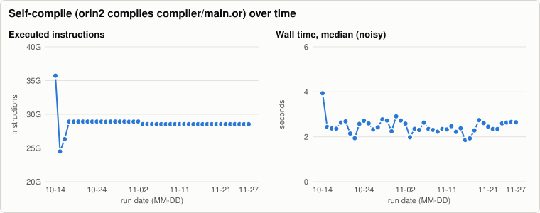

# Orin benchmark history

Written by `.github/workflows/bench.yml` (nightly and manual runs on `main`); one JSON file per run in [`history/`](history/), charts rendered by `tooling/benchmarks` (`bench-report render`, no external services). The same data as a stand-alone page: [`report.html`](report.html). Metrics and methodology: `docs/benchmarks.md` on `main`. Do not edit this branch by hand.

35 runs, 2026-10-14 to 2026-11-18. Latest: [`7635a6de4b`](https://github.com/HenrySchwerdt/orin/commit/7635a6de4ba00d5f68f1c6355860428eaad22201).

Instruction counts are the regression metric: they are deterministic for single-threaded programs, while wall time on a shared runner moves by 10-25 % between identical binaries.

## Latest run

Commit `7635a6de4b` (main), 2026-11-18T12:53:40Z. Machine: AMD EPYC 9V74 80-Core Processor, 4 cores, 15.6 GiB, Linux-7.0.0-1019-azure-x86_64-with-glibc2.43. Runs per cell: 5 (median after one warm-up).

Tool versions

- cc: `cc (Ubuntu 15.2.0-16ubuntu1) 15.2.0`
- clang: `Ubuntu clang version 21.1.8 (6ubuntu1)`
- go: `go version go1.24.13 linux/amd64`
- java: `openjdk version "21.0.13" 2026-10-20 LTS`
- python: `3.14.4`
- rustc: `rustc 1.100.0 (0ef1bc386 2026-11-09)`
- valgrind: `valgrind-3.26.0`

### Wall time, seconds (median; min-max)

| benchmark | Orin (C backend) | Orin (LLVM backend) | C | Go | Java | Rust |
|---|---:|---:|---:|---:|---:|---:|
| appends | 0.009 (0.009-0.009) | 0.008 (0.007-0.008) | 0.005 (0.005-0.005) | 0.014 (0.013-0.017) | 0.073 (0.064-0.085) | 0.004 (0.004-0.004) |
| bintrees | 0.428 (0.427-0.433) | 0.413 (0.410-0.421) | 1.037 (1.032-1.107) | 1.260 (1.255-1.266) | 0.348 (0.344-0.356) | 1.236 (1.227-1.238) |
| bytesstr | 0.041 (0.041-0.042) | 0.036 (0.036-0.036) | 0.023 (0.023-0.023) | 0.011 (0.010-0.015) | 0.100 (0.099-0.102) | 0.042 (0.041-0.042) |
| fib | 0.278 (0.278-0.279) | 0.351 (0.351-0.352) | 0.172 (0.172-0.172) | 0.663 (0.662-0.664) | 0.412 (0.401-0.426) | 0.350 (0.350-0.350) |
| html | 0.158 (0.156-0.159) | 0.130 (0.126-0.131) | 0.143 (0.142-0.143) | 0.235 (0.229-0.252) | n/a | n/a |
| html_hand | 0.129 (0.129-0.130) | 0.097 (0.096-0.097) | n/a | n/a | n/a | n/a |
| http_parse | 0.120 (0.119-0.121) | 0.104 (0.103-0.104) | n/a | n/a | n/a | n/a |
| mapfreq | 0.160 (0.160-0.169) | 0.160 (0.160-0.162) | 0.077 (0.075-0.078) | 0.115 (0.114-0.116) | n/a | n/a |
| mutres | 0.187 (0.185-0.189) | 0.150 (0.149-0.150) | 0.041 (0.041-0.041) | 0.047 (0.046-0.047) | 0.087 (0.083-0.091) | 0.041 (0.041-0.042) |
| nbody | 0.070 (0.070-0.071) | 0.084 (0.084-0.085) | 0.083 (0.083-0.083) | 0.093 (0.091-0.094) | n/a | n/a |
| pqueue | 0.162 (0.161-0.167) | 0.135 (0.131-0.135) | 0.079 (0.078-0.080) | 0.210 (0.207-0.217) | 0.267 (0.254-0.276) | 0.097 (0.096-0.097) |
| qsort_func | 0.227 (0.225-0.230) | 0.232 (0.231-0.234) | 0.207 (0.207-0.208) | 0.427 (0.420-0.447) | n/a | n/a |
| qsort_inplace | 0.125 (0.125-0.128) | 0.136 (0.134-0.140) | 0.096 (0.096-0.097) | 0.141 (0.141-0.145) | n/a | n/a |
| sieve | 0.121 (0.120-0.125) | 0.128 (0.125-0.130) | 0.109 (0.107-0.113) | 0.474 (0.387-0.522) | 0.172 (0.164-0.174) | 0.113 (0.112-0.118) |
| sortedmap | 0.265 (0.264-0.265) | 0.277 (0.276-0.277) | n/a | n/a | n/a | n/a |
| streams | 0.126 (0.126-0.127) | 0.124 (0.124-0.124) | n/a | n/a | n/a | n/a |
| strings | 0.081 (0.080-0.081) | 0.085 (0.080-0.086) | 0.070 (0.069-0.071) | 0.077 (0.074-0.090) | 0.236 (0.235-0.239) | 0.032 (0.031-0.032) |
| tasks | 4.194 (4.164-4.229) | 4.191 (4.162-4.265) | n/a | n/a | n/a | n/a |
| url | 0.380 (0.376-0.384) | 0.337 (0.323-0.340) | n/a | n/a | n/a | n/a |
| wordfreq | 0.130 (0.129-0.131) | 0.126 (0.125-0.126) | 0.107 (0.105-0.115) | 0.122 (0.121-0.122) | n/a | n/a |

### Ratio to C (wall-time median; lower is better, 1.00x = as fast as C)

| benchmark | Orin C/C | Orin LLVM/C | Go/C | Java/C | Rust/C |
|---|---:|---:|---:|---:|---:|
| appends | 1.89x | 1.55x | 2.88x | 14.96x | 0.84x |
| bintrees | 0.41x | 0.40x | 1.21x | 0.34x | 1.19x |
| bytesstr | 1.80x | 1.56x | 0.47x | 4.40x | 1.83x |
| fib | 1.62x | 2.04x | 3.85x | 2.39x | 2.03x |
| html | 1.11x | 0.91x | 1.65x | n/a | n/a |
| html_hand | n/a | n/a | n/a | n/a | n/a |
| http_parse | n/a | n/a | n/a | n/a | n/a |
| mapfreq | 2.09x | 2.09x | 1.49x | n/a | n/a |
| mutres | 4.60x | 3.68x | 1.15x | 2.13x | 1.01x |
| nbody | 0.85x | 1.01x | 1.13x | n/a | n/a |
| pqueue | 2.06x | 1.71x | 2.66x | 3.39x | 1.23x |
| qsort_func | 1.09x | 1.12x | 2.06x | n/a | n/a |
| qsort_inplace | 1.30x | 1.41x | 1.47x | n/a | n/a |
| sieve | 1.11x | 1.17x | 4.34x | 1.57x | 1.03x |
| sortedmap | n/a | n/a | n/a | n/a | n/a |
| streams | n/a | n/a | n/a | n/a | n/a |
| strings | 1.16x | 1.22x | 1.11x | 3.39x | 0.46x |
| tasks | n/a | n/a | n/a | n/a | n/a |
| url | n/a | n/a | n/a | n/a | n/a |
| wordfreq | 1.22x | 1.18x | 1.14x | n/a | n/a |

### CPU time (user + sys, median s) and peak RSS (MiB)

| benchmark | orin CPU | llvm CPU | c CPU | go CPU | java CPU | rust CPU | orin RSS | llvm RSS | c RSS | go RSS | java RSS | rust RSS |
|---|---:|---:|---:|---:|---:|---:|---:|---:|---:|---:|---:|---:|
| appends | 0.009 | 0.007 | 0.005 | 0.020 | 0.108 | 0.004 | 4.8 | 5.0 | 4.8 | 9.8 | 47.8 | 5.2 |
| bintrees | 0.427 | 0.413 | 1.037 | 2.640 | 0.399 | 1.235 | 17.7 | 17.9 | 9.6 | 12.6 | 301.3 | 10.0 |
| bytesstr | 0.041 | 0.035 | 0.023 | 0.017 | 0.120 | 0.042 | 11.6 | 11.9 | 11.6 | 7.2 | 103.3 | 5.0 |
| fib | 0.278 | 0.351 | 0.172 | 0.665 | 0.424 | 0.350 | 1.6 | 1.9 | 1.5 | 1.7 | 38.8 | 2.1 |
| html | 0.158 | 0.130 | 0.143 | 0.313 | n/a | n/a | 4.0 | 4.2 | 2.1 | 7.5 | n/a | n/a |
| html_hand | 0.129 | 0.097 | n/a | n/a | n/a | n/a | 2.6 | 2.9 | n/a | n/a | n/a | n/a |
| http_parse | 0.120 | 0.104 | n/a | n/a | n/a | n/a | 1.8 | 2.0 | n/a | n/a | n/a | n/a |
| mapfreq | 0.160 | 0.160 | 0.076 | 0.128 | n/a | n/a | 11.2 | 11.4 | 5.0 | 7.6 | n/a | n/a |
| mutres | 0.187 | 0.149 | 0.040 | 0.047 | 0.117 | 0.041 | 1.7 | 1.8 | 1.5 | 1.6 | 39.2 | 2.1 |
| nbody | 0.070 | 0.083 | 0.082 | 0.094 | n/a | n/a | 1.9 | 1.9 | 1.9 | 1.6 | n/a | n/a |
| pqueue | 0.162 | 0.134 | 0.079 | 0.224 | 0.336 | 0.096 | 6.3 | 6.5 | 4.8 | 15.0 | 62.2 | 5.2 |
| qsort_func | 0.227 | 0.232 | 0.207 | 0.541 | n/a | n/a | 36.4 | 36.6 | 22.0 | 39.0 | n/a | n/a |
| qsort_inplace | 0.125 | 0.136 | 0.096 | 0.181 | n/a | n/a | 16.9 | 17.1 | 16.8 | 35.6 | n/a | n/a |
| sieve | 0.121 | 0.128 | 0.109 | 0.780 | 0.197 | 0.113 | 77.9 | 78.2 | 77.7 | 303.9 | 116.2 | 78.5 |
| sortedmap | 0.264 | 0.276 | n/a | n/a | n/a | n/a | 11.3 | 11.6 | n/a | n/a | n/a | n/a |
| streams | 0.126 | 0.124 | n/a | n/a | n/a | n/a | 39.8 | 40.1 | n/a | n/a | n/a | n/a |
| strings | 0.080 | 0.085 | 0.069 | 0.101 | 0.452 | 0.032 | 46.3 | 46.5 | 34.8 | 21.6 | 139.6 | 20.1 |
| tasks | 5.033 | 4.991 | n/a | n/a | n/a | n/a | 14.1 | 14.4 | n/a | n/a | n/a | n/a |
| url | 0.379 | 0.337 | n/a | n/a | n/a | n/a | 6.6 | 6.7 | n/a | n/a | n/a | n/a |
| wordfreq | 0.130 | 0.125 | 0.106 | 0.124 | n/a | n/a | 2.3 | 2.6 | 1.9 | 6.6 | n/a | n/a |

### Executed instructions (valgrind; the regression metric)

| benchmark | Orin C | Orin LLVM | C | Orin C/C | Orin LLVM/C | note |
|---|---:|---:|---:|---:|---:|---|
| appends | 60,396,257 | 43,975,557 | 18,927,362 | 3.19x | 2.32x |  |
| bintrees | 4,351,239,711 | 4,313,425,955 | 11,630,513,487 | 0.37x | 0.37x |  |
| bytesstr | 349,643,257 | 259,442,315 | 103,926,179 | 3.36x | 2.50x |  |
| fib | 3,200,255,443 | 2,342,472,329 | 2,780,168,025 | 1.15x | 0.84x |  |
| html | 1,578,539,376 | 1,388,947,352 | 1,521,579,597 | 1.04x | 0.91x |  |
| html_hand | 1,201,366,951 | 989,088,189 | n/a | n/a | n/a |  |
| http_parse | 1,507,219,853 | 1,363,867,923 | n/a | n/a | n/a |  |
| mapfreq | 1,014,961,827 | 996,989,254 | 682,001,898 | 1.49x | 1.46x |  |
| mutres | 2,470,217,982 | 2,030,196,321 | 267,648,838 | 9.23x | 7.59x |  |
| nbody | 464,252,863 | 768,198,854 | 386,175,662 | 1.20x | 1.99x |  |
| pqueue | 1,383,384,499 | 1,325,195,828 | 359,470,793 | 3.85x | 3.69x |  |
| qsort_func | 1,317,510,895 | 1,279,283,102 | 1,064,640,591 | 1.24x | 1.20x |  |
| qsort_inplace | 622,537,034 | 521,083,733 | 275,674,745 | 2.26x | 1.89x |  |
| sieve | 390,345,736 | 451,732,211 | 161,705,036 | 2.41x | 2.79x |  |
| sortedmap | 1,335,062,300 | 1,343,621,855 | n/a | n/a | n/a |  |
| streams | 1,173,822,977 | 1,173,802,851 | n/a | n/a | n/a |  |
| strings | 653,658,157 | 580,559,129 | 734,241,501 | 0.89x | 0.79x |  |
| tasks | n/a | n/a | n/a | n/a | n/a | llvm skipped: multi-threaded (20,000 tasks, channels): valgrind serialises threads, so the count would include scheduler waits; orin skipped: multi-threaded (20,000 tasks, channels): valgrind serialises threads, so the count would include scheduler waits |
| url | 4,584,662,794 | 4,368,675,430 | n/a | n/a | n/a |  |
| wordfreq | 755,666,515 | 708,712,081 | 860,830,646 | 0.88x | 0.82x |  |

### Parallel speedup (std:task; worker threads = first argument of the program)

| benchmark | threads | wall s (min-max) | CPU s (user+sys) | speedup | efficiency | CPU vs 1 thread | output |
|---|---:|---:|---:|---:|---:|---:|---|
| parallel_collatz | 1 | 0.541 (0.540-0.542) | 0.541 | 1.00x | 100 % | 1.00x | same |
| parallel_collatz | 2 | 0.318 (0.317-0.319) | 0.575 | 1.70x | 85 % | 1.06x | same |
| parallel_collatz | 4 | 0.207 (0.206-0.207) | 0.698 | 2.62x | 65 % | 1.29x | same |
| streams_parallel | 1 | 0.529 (0.529-0.530) | 0.529 | 1.00x | 100 % | 1.00x | same |
| streams_parallel | 2 | 0.278 (0.278-0.279) | 0.532 | 1.90x | 95 % | 1.01x | same |
| streams_parallel | 4 | 0.174 (0.173-0.175) | 0.620 | 3.04x | 76 % | 1.17x | same |

Speedup = wall(1 thread) / wall(n); efficiency = speedup / n. CPU time that grows with n is overhead or oversubscription (more threads than free cores).

### Self-compile (orin2 compiles compiler/main.or)

| wall s (min-max) | CPU s | peak RSS MiB | instructions | output identical to stage2.c |
|---:|---:|---:|---:|---|
| 2.742 (2.700-2.809) | 4.852 | 394.9 | 28,542,480,299 | yes |

## All runs

| date | commit | ref | self-compile instructions | self-compile wall s | file |
|---|---|---|---:|---:|---|
| 2026-11-18T12:53:40Z | `7635a6de4b` | main | 28,542,480,299 | 2.742 | [json](history/2026-11-18-7635a6de4ba0.json) |
| 2026-11-17T12:57:26Z | `7635a6de4b` | main | 28,543,095,342 | 2.282 | [json](history/2026-11-17-7635a6de4ba0.json) |
| 2026-11-16T12:34:51Z | `7635a6de4b` | main | 28,541,439,702 | 1.930 | [json](history/2026-11-16-7635a6de4ba0.json) |
| 2026-11-15T11:54:27Z | `7635a6de4b` | main | 28,542,663,271 | 1.858 | [json](history/2026-11-15-7635a6de4ba0.json) |
| 2026-11-14T11:29:07Z | `7635a6de4b` | main | 28,541,943,893 | 2.378 | [json](history/2026-11-14-7635a6de4ba0.json) |
| 2026-11-13T12:02:42Z | `7635a6de4b` | main | 28,542,382,986 | 2.218 | [json](history/2026-11-13-7635a6de4ba0.json) |
| 2026-11-12T12:22:16Z | `7635a6de4b` | main | 28,542,960,948 | 2.473 | [json](history/2026-11-12-7635a6de4ba0.json) |
| 2026-11-11T11:53:47Z | `7635a6de4b` | main | 28,542,808,219 | 2.327 | [json](history/2026-11-11-7635a6de4ba0.json) |
| 2026-11-10T12:19:35Z | `7635a6de4b` | main | 28,542,948,040 | 2.345 | [json](history/2026-11-10-7635a6de4ba0.json) |
| 2026-11-09T12:46:20Z | `7635a6de4b` | main | 28,542,360,770 | 2.228 | [json](history/2026-11-09-7635a6de4ba0.json) |
| 2026-11-08T11:13:42Z | `7635a6de4b` | main | 28,542,100,863 | 2.306 | [json](history/2026-11-08-7635a6de4ba0.json) |
| 2026-11-07T11:05:37Z | `7635a6de4b` | main | 28,542,838,708 | 2.349 | [json](history/2026-11-07-7635a6de4ba0.json) |
| 2026-11-06T12:14:12Z | `7635a6de4b` | main | 28,542,494,981 | 2.629 | [json](history/2026-11-06-7635a6de4ba0.json) |
| 2026-11-05T12:03:31Z | `7635a6de4b` | main | 28,542,603,064 | 2.304 | [json](history/2026-11-05-7635a6de4ba0.json) |
| 2026-11-04T12:01:20Z | `7635a6de4b` | main | 28,542,780,461 | 2.352 | [json](history/2026-11-04-7635a6de4ba0.json) |
| 2026-11-03T11:46:50Z | `7635a6de4b` | main | 28,542,833,519 | 1.976 | [json](history/2026-11-03-7635a6de4ba0.json) |
| 2026-11-02T12:12:00Z | `7635a6de4b` | main | 28,930,351,842 | 2.587 | [json](history/2026-11-02-7635a6de4ba0.json) |
| 2026-11-01T11:15:45Z | `7635a6de4b` | main | 28,919,490,355 | 2.724 | [json](history/2026-11-01-7635a6de4ba0.json) |
| 2026-10-31T10:26:16Z | `7635a6de4b` | main | 28,907,840,339 | 2.912 | [json](history/2026-10-31-7635a6de4ba0.json) |
| 2026-10-30T10:52:47Z | `7635a6de4b` | main | 28,929,137,893 | 2.245 | [json](history/2026-10-30-7635a6de4ba0.json) |
| 2026-10-29T10:57:02Z | `7635a6de4b` | main | 28,928,714,860 | 2.725 | [json](history/2026-10-29-7635a6de4ba0.json) |
| 2026-10-28T10:34:30Z | `7635a6de4b` | main | 28,927,700,571 | 2.775 | [json](history/2026-10-28-7635a6de4ba0.json) |
| 2026-10-27T09:54:38Z | `7635a6de4b` | main | 28,929,325,676 | 2.422 | [json](history/2026-10-27-7635a6de4ba0.json) |
| 2026-10-26T09:51:57Z | `7635a6de4b` | main | 28,898,057,347 | 2.328 | [json](history/2026-10-26-7635a6de4ba0.json) |
| 2026-10-25T09:10:57Z | `7635a6de4b` | main | 28,925,568,576 | 2.594 | [json](history/2026-10-25-7635a6de4ba0.json) |
| 2026-10-24T08:51:56Z | `7635a6de4b` | main | 28,924,241,295 | 2.708 | [json](history/2026-10-24-7635a6de4ba0.json) |
| 2026-10-23T09:21:38Z | `7635a6de4b` | main | 28,928,848,177 | 2.577 | [json](history/2026-10-23-7635a6de4ba0.json) |
| 2026-10-22T09:18:06Z | `7635a6de4b` | main | 28,927,908,288 | 1.939 | [json](history/2026-10-22-7635a6de4ba0.json) |
| 2026-10-21T09:16:22Z | `7635a6de4b` | main | 28,929,128,127 | 2.146 | [json](history/2026-10-21-7635a6de4ba0.json) |
| 2026-10-20T09:21:19Z | `7635a6de4b` | main | 28,924,224,488 | 2.688 | [json](history/2026-10-20-7635a6de4ba0.json) |
| 2026-10-19T09:49:07Z | `7635a6de4b` | main | 28,920,330,777 | 2.632 | [json](history/2026-10-19-7635a6de4ba0.json) |
| 2026-10-18T08:43:59Z | `7635a6de4b` | main | 28,927,449,240 | 2.360 | [json](history/2026-10-18-7635a6de4ba0.json) |
| 2026-10-17T08:29:19Z | `d0a17a9682` | main | 26,314,861,202 | 2.370 | [json](history/2026-10-17-d0a17a968285.json) |
| 2026-10-16T08:55:17Z | `9f83f16af4` | main | 24,496,056,957 | 2.438 | [json](history/2026-10-16-9f83f16af402.json) |
| 2026-10-14T17:32:27Z | `f837889af7` | main | 35,729,157,194 | 3.937 | [json](history/2026-10-14-f837889af7a9.json) |
