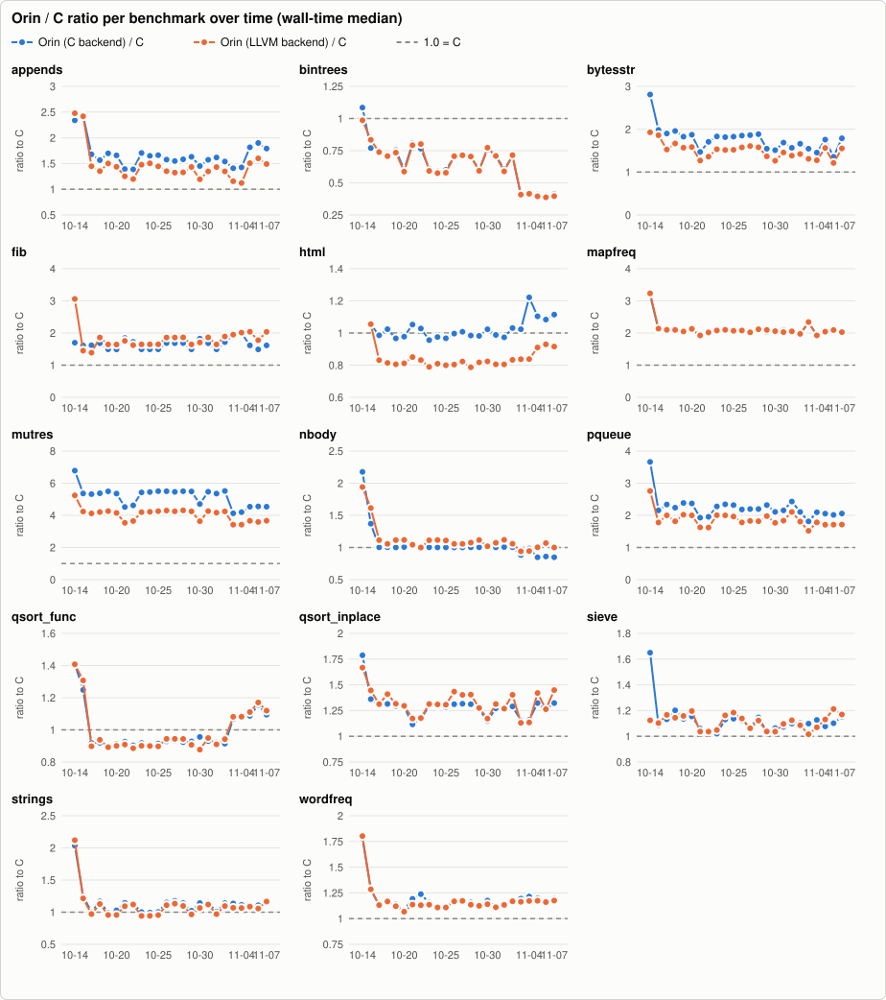
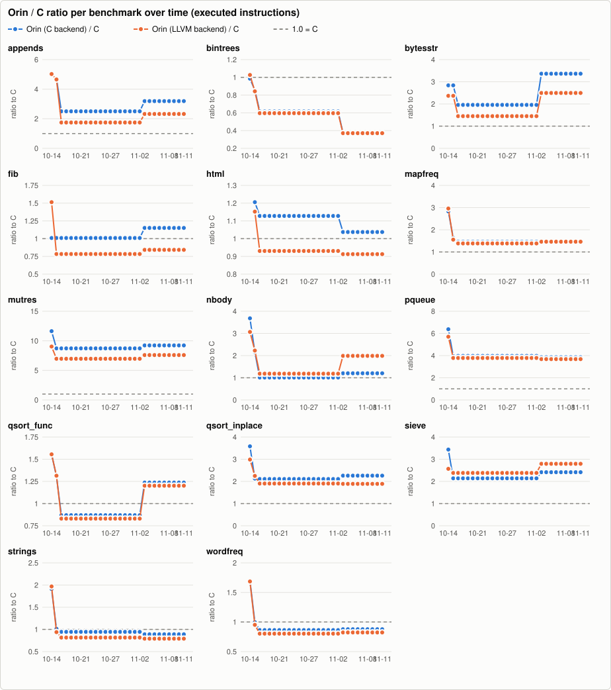
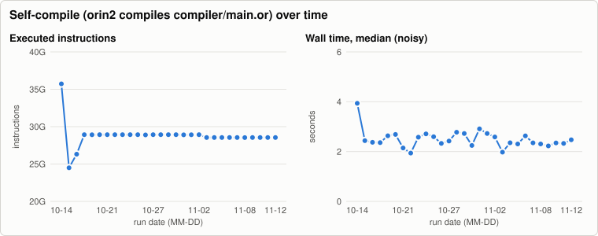
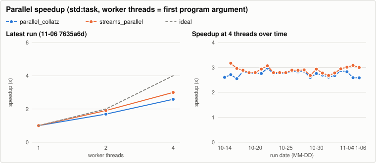

# Orin benchmark history

Written by `.github/workflows/bench.yml` (nightly and manual runs on `main`); one JSON file per run in [`history/`](history/), charts rendered by `tooling/benchmarks` (`bench-report render`, no external services). The same data as a stand-alone page: [`report.html`](report.html). Metrics and methodology: `docs/benchmarks.md` on `main`. Do not edit this branch by hand.

18 runs, 2026-10-14 to 2026-11-01. Latest: [`7635a6de4b`](https://github.com/HenrySchwerdt/orin/commit/7635a6de4ba00d5f68f1c6355860428eaad22201).

Instruction counts are the regression metric: they are deterministic for single-threaded programs, while wall time on a shared runner moves by 10-25 % between identical binaries.

## Latest run

Commit `7635a6de4b` (main), 2026-11-01T11:15:45Z. Machine: AMD EPYC 7763 64-Core Processor, 4 cores, 15.6 GiB, Linux-7.0.0-1017-azure-x86_64-with-glibc2.39. Runs per cell: 5 (median after one warm-up).

Tool versions

- cc: `cc (Ubuntu 13.3.0-6ubuntu2~24.04.1) 13.3.0`
- clang: `Ubuntu clang version 18.1.3 (1ubuntu1)`
- go: `go version go1.24.13 linux/amd64`
- java: `openjdk version "21.0.13" 2026-10-20 LTS`
- python: `3.12.3`
- rustc: `rustc 1.99.1 (58cf8f9c3 2026-10-13)`
- valgrind: `valgrind-3.22.0`

### Wall time, seconds (median; min-max)

| benchmark | Orin (C backend) | Orin (LLVM backend) | C | Go | Java | Rust |
|---|---:|---:|---:|---:|---:|---:|
| appends | 0.009 (0.009-0.009) | 0.008 (0.008-0.008) | 0.005 (0.005-0.006) | 0.015 (0.014-0.017) | 0.068 (0.067-0.085) | 0.005 (0.005-0.005) |
| bintrees | 0.409 (0.404-0.415) | 0.398 (0.395-0.403) | 0.676 (0.674-0.689) | 1.297 (1.292-1.317) | 0.334 (0.334-0.344) | 0.709 (0.707-0.711) |
| bytesstr | 0.040 (0.039-0.040) | 0.035 (0.035-0.035) | 0.025 (0.025-0.026) | 0.010 (0.009-0.012) | 0.099 (0.099-0.111) | 0.039 (0.039-0.042) |
| fib | 0.296 (0.296-0.297) | 0.326 (0.326-0.326) | 0.198 (0.198-0.199) | 0.597 (0.593-0.601) | 0.429 (0.422-0.437) | 0.314 (0.313-0.315) |
| html | 0.165 (0.164-0.166) | 0.137 (0.135-0.140) | 0.170 (0.168-0.175) | 0.247 (0.242-0.263) | n/a | n/a |
| html_hand | 0.131 (0.129-0.133) | 0.102 (0.099-0.105) | n/a | n/a | n/a | n/a |
| http_parse | 0.130 (0.130-0.131) | 0.116 (0.116-0.117) | n/a | n/a | n/a | n/a |
| mapfreq | 0.160 (0.159-0.162) | 0.161 (0.161-0.167) | 0.079 (0.077-0.079) | 0.119 (0.118-0.120) | n/a | n/a |
| mutres | 0.174 (0.173-0.174) | 0.135 (0.135-0.137) | 0.032 (0.032-0.033) | 0.045 (0.045-0.046) | 0.089 (0.086-0.094) | 0.038 (0.038-0.039) |
| nbody | 0.071 (0.070-0.071) | 0.079 (0.078-0.079) | 0.070 (0.070-0.071) | 0.088 (0.087-0.089) | n/a | n/a |
| pqueue | 0.158 (0.154-0.159) | 0.137 (0.136-0.140) | 0.065 (0.065-0.066) | 0.210 (0.207-0.213) | 0.277 (0.255-0.288) | 0.101 (0.097-0.105) |
| qsort_func | 0.221 (0.220-0.223) | 0.218 (0.218-0.219) | 0.240 (0.240-0.243) | 0.430 (0.421-0.439) | n/a | n/a |
| qsort_inplace | 0.109 (0.109-0.110) | 0.111 (0.111-0.112) | 0.087 (0.087-0.088) | 0.126 (0.124-0.137) | n/a | n/a |
| sieve | 0.132 (0.129-0.133) | 0.135 (0.129-0.136) | 0.120 (0.120-0.120) | 0.374 (0.321-0.447) | 0.188 (0.183-0.189) | 0.119 (0.115-0.121) |
| sortedmap | 0.265 (0.259-0.275) | 0.295 (0.276-0.308) | n/a | n/a | n/a | n/a |
| streams | 0.131 (0.131-0.134) | 0.111 (0.111-0.112) | n/a | n/a | n/a | n/a |
| strings | 0.077 (0.077-0.078) | 0.074 (0.074-0.075) | 0.076 (0.076-0.077) | 0.086 (0.077-0.088) | 0.241 (0.235-0.248) | 0.032 (0.032-0.033) |
| tasks | 4.133 (4.062-4.285) | 4.126 (4.045-4.185) | n/a | n/a | n/a | n/a |
| url | 0.381 (0.380-0.381) | 0.347 (0.346-0.348) | n/a | n/a | n/a | n/a |
| wordfreq | 0.127 (0.126-0.128) | 0.126 (0.125-0.126) | 0.111 (0.111-0.113) | 0.118 (0.115-0.119) | n/a | n/a |

### Ratio to C (wall-time median; lower is better, 1.00x = as fast as C)

| benchmark | Orin C/C | Orin LLVM/C | Go/C | Java/C | Rust/C |
|---|---:|---:|---:|---:|---:|
| appends | 1.62x | 1.43x | 2.77x | 12.51x | 0.86x |
| bintrees | 0.61x | 0.59x | 1.92x | 0.49x | 1.05x |
| bytesstr | 1.57x | 1.38x | 0.40x | 3.93x | 1.55x |
| fib | 1.49x | 1.65x | 3.01x | 2.16x | 1.58x |
| html | 0.97x | 0.81x | 1.46x | n/a | n/a |
| html_hand | n/a | n/a | n/a | n/a | n/a |
| http_parse | n/a | n/a | n/a | n/a | n/a |
| mapfreq | 2.04x | 2.05x | 1.51x | n/a | n/a |
| mutres | 5.36x | 4.17x | 1.40x | 2.73x | 1.18x |
| nbody | 1.01x | 1.12x | 1.25x | n/a | n/a |
| pqueue | 2.43x | 2.10x | 3.22x | 4.26x | 1.55x |
| qsort_func | 0.92x | 0.91x | 1.79x | n/a | n/a |
| qsort_inplace | 1.25x | 1.27x | 1.44x | n/a | n/a |
| sieve | 1.10x | 1.12x | 3.12x | 1.56x | 0.99x |
| sortedmap | n/a | n/a | n/a | n/a | n/a |
| streams | n/a | n/a | n/a | n/a | n/a |
| strings | 1.01x | 0.97x | 1.12x | 3.15x | 0.42x |
| tasks | n/a | n/a | n/a | n/a | n/a |
| url | n/a | n/a | n/a | n/a | n/a |
| wordfreq | 1.15x | 1.13x | 1.06x | n/a | n/a |

### CPU time (user + sys, median s) and peak RSS (MiB)

| benchmark | orin CPU | llvm CPU | c CPU | go CPU | java CPU | rust CPU | orin RSS | llvm RSS | c RSS | go RSS | java RSS | rust RSS |
|---|---:|---:|---:|---:|---:|---:|---:|---:|---:|---:|---:|---:|
| appends | 0.009 | 0.008 | 0.005 | 0.022 | 0.110 | 0.004 | 4.5 | 4.8 | 4.7 | 9.8 | 47.6 | 5.0 |
| bintrees | 0.409 | 0.397 | 0.675 | 2.833 | 0.395 | 0.709 | 17.5 | 17.8 | 9.5 | 12.3 | 301.0 | 10.0 |
| bytesstr | 0.039 | 0.035 | 0.025 | 0.015 | 0.121 | 0.039 | 11.5 | 11.8 | 11.6 | 6.3 | 104.4 | 4.8 |
| fib | 0.295 | 0.326 | 0.198 | 0.599 | 0.441 | 0.314 | 1.5 | 1.7 | 1.5 | 1.8 | 38.5 | 1.8 |
| html | 0.165 | 0.136 | 0.169 | 0.330 | n/a | n/a | 3.7 | 4.1 | 2.1 | 7.4 | n/a | n/a |
| html_hand | 0.130 | 0.101 | n/a | n/a | n/a | n/a | 2.4 | 2.7 | n/a | n/a | n/a | n/a |
| http_parse | 0.130 | 0.116 | n/a | n/a | n/a | n/a | 1.6 | 1.9 | n/a | n/a | n/a | n/a |
| mapfreq | 0.159 | 0.161 | 0.078 | 0.134 | n/a | n/a | 11.3 | 11.6 | 5.0 | 7.3 | n/a | n/a |
| mutres | 0.173 | 0.135 | 0.032 | 0.046 | 0.118 | 0.038 | 1.5 | 1.7 | 1.5 | 1.8 | 38.9 | 2.0 |
| nbody | 0.070 | 0.078 | 0.070 | 0.089 | n/a | n/a | 1.8 | 1.8 | 1.8 | 1.7 | n/a | n/a |
| pqueue | 0.158 | 0.137 | 0.065 | 0.227 | 0.347 | 0.100 | 6.1 | 6.4 | 4.7 | 14.7 | 62.0 | 5.0 |
| qsort_func | 0.221 | 0.218 | 0.239 | 0.549 | n/a | n/a | 36.4 | 36.6 | 23.7 | 44.0 | n/a | n/a |
| qsort_inplace | 0.109 | 0.111 | 0.087 | 0.166 | n/a | n/a | 16.7 | 17.0 | 16.7 | 31.0 | n/a | n/a |
| sieve | 0.132 | 0.135 | 0.120 | 0.578 | 0.214 | 0.119 | 77.7 | 78.0 | 77.6 | 280.0 | 116.0 | 78.3 |
| sortedmap | 0.265 | 0.294 | n/a | n/a | n/a | n/a | 11.1 | 11.4 | n/a | n/a | n/a | n/a |
| streams | 0.131 | 0.111 | n/a | n/a | n/a | n/a | 39.6 | 39.9 | n/a | n/a | n/a | n/a |
| strings | 0.077 | 0.073 | 0.076 | 0.118 | 0.473 | 0.032 | 46.1 | 46.3 | 34.6 | 23.5 | 139.3 | 19.8 |
| tasks | 4.927 | 4.824 | n/a | n/a | n/a | n/a | 14.0 | 14.4 | n/a | n/a | n/a | n/a |
| url | 0.380 | 0.346 | n/a | n/a | n/a | n/a | 6.4 | 6.7 | n/a | n/a | n/a | n/a |
| wordfreq | 0.127 | 0.126 | 0.111 | 0.121 | n/a | n/a | 2.2 | 2.6 | 1.9 | 6.5 | n/a | n/a |

### Executed instructions (valgrind; the regression metric)

| benchmark | Orin C | Orin LLVM | C | Orin C/C | Orin LLVM/C | note |
|---|---:|---:|---:|---:|---:|---|
| appends | 63,530,238 | 44,305,230 | 25,381,131 | 2.50x | 1.75x |  |
| bintrees | 4,457,305,556 | 4,319,515,246 | 7,242,293,433 | 0.62x | 0.60x |  |
| bytesstr | 349,907,887 | 259,441,178 | 178,695,497 | 1.96x | 1.45x |  |
| fib | 3,200,318,149 | 2,483,953,789 | 3,170,983,187 | 1.01x | 0.78x |  |
| html | 1,784,203,884 | 1,471,870,947 | 1,581,660,500 | 1.13x | 0.93x |  |
| html_hand | 1,332,890,919 | 987,886,037 | n/a | n/a | n/a |  |
| http_parse | 1,539,178,551 | 1,358,991,092 | n/a | n/a | n/a |  |
| mapfreq | 1,050,624,793 | 995,125,501 | 717,968,421 | 1.46x | 1.39x |  |
| mutres | 2,541,530,953 | 2,030,255,622 | 291,450,138 | 8.72x | 6.97x |  |
| nbody | 658,315,521 | 772,258,305 | 651,230,691 | 1.01x | 1.19x |  |
| pqueue | 1,411,252,308 | 1,344,413,179 | 355,213,580 | 3.97x | 3.78x |  |
| qsort_func | 1,329,379,242 | 1,269,367,690 | 1,528,677,747 | 0.87x | 0.83x |  |
| qsort_inplace | 576,878,278 | 521,077,518 | 273,751,964 | 2.11x | 1.90x |  |
| sieve | 410,343,299 | 456,726,111 | 191,756,537 | 2.14x | 2.38x |  |
| sortedmap | 1,356,615,067 | 1,358,427,082 | n/a | n/a | n/a |  |
| streams | 1,173,755,264 | 1,173,731,319 | n/a | n/a | n/a |  |
| strings | 647,532,817 | 559,940,890 | 685,893,516 | 0.94x | 0.82x |  |
| tasks | n/a | n/a | n/a | n/a | n/a | llvm skipped: multi-threaded (20,000 tasks, channels): valgrind serialises threads, so the count would include scheduler waits; orin skipped: multi-threaded (20,000 tasks, channels): valgrind serialises threads, so the count would include scheduler waits |
| url | 4,852,179,714 | 4,363,458,753 | n/a | n/a | n/a |  |
| wordfreq | 760,378,192 | 707,684,195 | 880,488,803 | 0.86x | 0.80x |  |

### Parallel speedup (std:task; worker threads = first argument of the program)

| benchmark | threads | wall s (min-max) | CPU s (user+sys) | speedup | efficiency | CPU vs 1 thread | output |
|---|---:|---:|---:|---:|---:|---:|---|
| parallel_collatz | 1 | 0.501 (0.496-0.501) | 0.501 | 1.00x | 100 % | 1.00x | same |
| parallel_collatz | 2 | 0.297 (0.295-0.299) | 0.535 | 1.69x | 84 % | 1.07x | same |
| parallel_collatz | 4 | 0.192 (0.191-0.192) | 0.644 | 2.61x | 65 % | 1.29x | same |
| streams_parallel | 1 | 0.491 (0.490-0.495) | 0.491 | 1.00x | 100 % | 1.00x | same |
| streams_parallel | 2 | 0.259 (0.258-0.259) | 0.492 | 1.90x | 95 % | 1.00x | same |
| streams_parallel | 4 | 0.183 (0.183-0.184) | 0.657 | 2.68x | 67 % | 1.34x | same |

Speedup = wall(1 thread) / wall(n); efficiency = speedup / n. CPU time that grows with n is overhead or oversubscription (more threads than free cores).

### Self-compile (orin2 compiles compiler/main.or)

| wall s (min-max) | CPU s | peak RSS MiB | instructions | output identical to stage2.c |
|---:|---:|---:|---:|---|
| 2.724 (2.704-2.729) | 4.842 | 393.7 | 28,919,490,355 | yes |

## All runs

| date | commit | ref | self-compile instructions | self-compile wall s | file |
|---|---|---|---:|---:|---|
| 2026-11-01T11:15:45Z | `7635a6de4b` | main | 28,919,490,355 | 2.724 | [json](history/2026-11-01-7635a6de4ba0.json) |
| 2026-10-31T10:26:16Z | `7635a6de4b` | main | 28,907,840,339 | 2.912 | [json](history/2026-10-31-7635a6de4ba0.json) |
| 2026-10-30T10:52:47Z | `7635a6de4b` | main | 28,929,137,893 | 2.245 | [json](history/2026-10-30-7635a6de4ba0.json) |
| 2026-10-29T10:57:02Z | `7635a6de4b` | main | 28,928,714,860 | 2.725 | [json](history/2026-10-29-7635a6de4ba0.json) |
| 2026-10-28T10:34:30Z | `7635a6de4b` | main | 28,927,700,571 | 2.775 | [json](history/2026-10-28-7635a6de4ba0.json) |
| 2026-10-27T09:54:38Z | `7635a6de4b` | main | 28,929,325,676 | 2.422 | [json](history/2026-10-27-7635a6de4ba0.json) |
| 2026-10-26T09:51:57Z | `7635a6de4b` | main | 28,898,057,347 | 2.328 | [json](history/2026-10-26-7635a6de4ba0.json) |
| 2026-10-25T09:10:57Z | `7635a6de4b` | main | 28,925,568,576 | 2.594 | [json](history/2026-10-25-7635a6de4ba0.json) |
| 2026-10-24T08:51:56Z | `7635a6de4b` | main | 28,924,241,295 | 2.708 | [json](history/2026-10-24-7635a6de4ba0.json) |
| 2026-10-23T09:21:38Z | `7635a6de4b` | main | 28,928,848,177 | 2.577 | [json](history/2026-10-23-7635a6de4ba0.json) |
| 2026-10-22T09:18:06Z | `7635a6de4b` | main | 28,927,908,288 | 1.939 | [json](history/2026-10-22-7635a6de4ba0.json) |
| 2026-10-21T09:16:22Z | `7635a6de4b` | main | 28,929,128,127 | 2.146 | [json](history/2026-10-21-7635a6de4ba0.json) |
| 2026-10-20T09:21:19Z | `7635a6de4b` | main | 28,924,224,488 | 2.688 | [json](history/2026-10-20-7635a6de4ba0.json) |
| 2026-10-19T09:49:07Z | `7635a6de4b` | main | 28,920,330,777 | 2.632 | [json](history/2026-10-19-7635a6de4ba0.json) |
| 2026-10-18T08:43:59Z | `7635a6de4b` | main | 28,927,449,240 | 2.360 | [json](history/2026-10-18-7635a6de4ba0.json) |
| 2026-10-17T08:29:19Z | `d0a17a9682` | main | 26,314,861,202 | 2.370 | [json](history/2026-10-17-d0a17a968285.json) |
| 2026-10-16T08:55:17Z | `9f83f16af4` | main | 24,496,056,957 | 2.438 | [json](history/2026-10-16-9f83f16af402.json) |
| 2026-10-14T17:32:27Z | `f837889af7` | main | 35,729,157,194 | 3.937 | [json](history/2026-10-14-f837889af7a9.json) |
