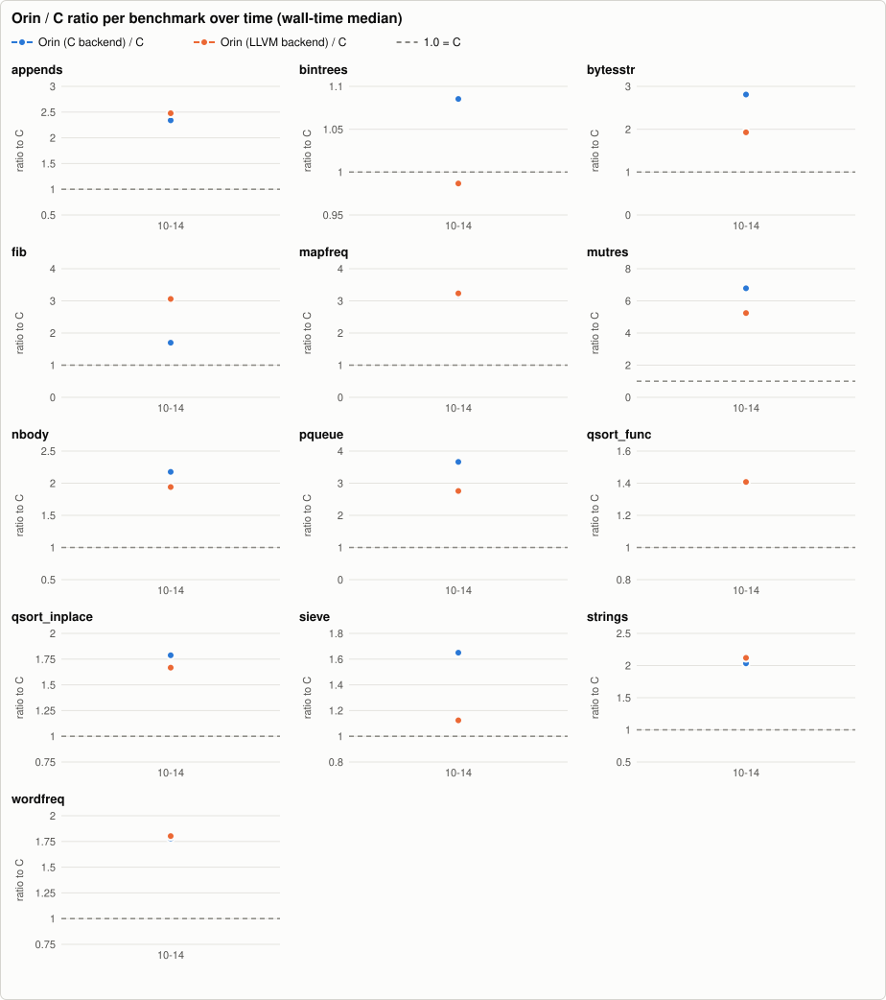
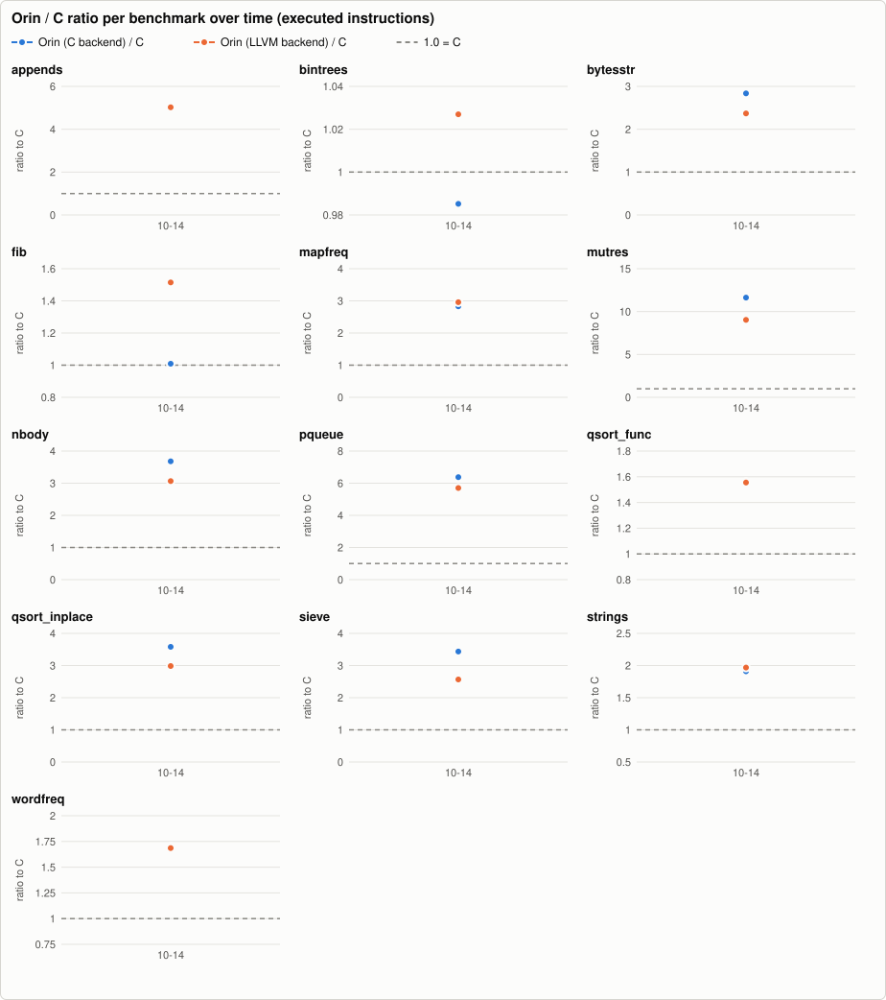
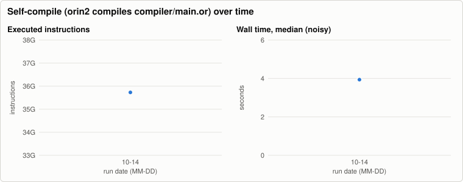
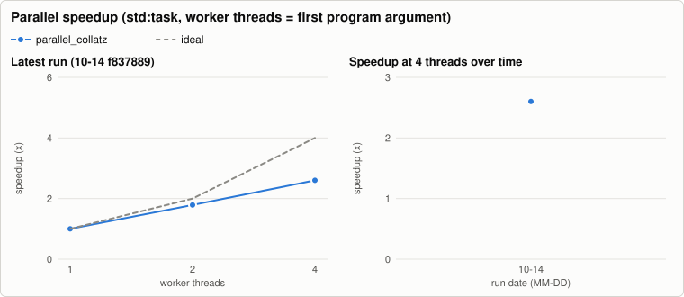

# Orin benchmark history

Written by `.github/workflows/bench.yml` (nightly and manual runs on `main`); one JSON file per run in [`history/`](history/), charts rendered by `tooling/benchmarks` (`bench-report render`, no external services). The same data as a stand-alone page: [`report.html`](report.html). Metrics and methodology: `docs/benchmarks.md` on `main`. Do not edit this branch by hand.

1 runs, 2026-10-14 to 2026-10-14. Latest: [`f837889af7`](https://github.com/orin-lang/orin-lang/commit/f837889af7a96f0e47d7d642d3c5f725faa86f98).

Instruction counts are the regression metric: they are deterministic for single-threaded programs, while wall time on a shared runner moves by 10-25 % between identical binaries.

## Latest run

Commit `f837889af7` (main), 2026-10-14T17:32:27Z. Machine: AMD EPYC 9V74 80-Core Processor, 4 cores, 15.6 GiB, Linux-6.17.0-1022-azure-x86_64-with-glibc2.39. Runs per cell: 5 (median after one warm-up).

Tool versions

- cc: `cc (Ubuntu 13.3.0-6ubuntu2~24.04.1) 13.3.0`
- clang: `Ubuntu clang version 18.1.3 (1ubuntu1)`
- go: `go version go1.24.13 linux/amd64`
- java: `openjdk version "21.0.12.1" 2026-08-18 LTS`
- python: `3.12.3`
- rustc: `rustc 1.99.0 (b940084d7 2026-09-28)`
- valgrind: `valgrind-3.22.0`

### Wall time, seconds (median; min-max)

| benchmark | Orin (C backend) | Orin (LLVM backend) | C | Go | Java | Rust |
|---|---:|---:|---:|---:|---:|---:|
| appends | 0.011 (0.010-0.011) | 0.011 (0.011-0.011) | 0.004 (0.004-0.005) | 0.005 (0.005-0.006) | 0.055 (0.049-0.062) | 0.003 (0.003-0.003) |
| bintrees | 0.527 (0.526-0.530) | 0.479 (0.478-0.490) | 0.486 (0.484-0.488) | 0.962 (0.953-0.972) | 0.167 (0.166-0.170) | 0.564 (0.562-0.565) |
| bytesstr | 0.041 (0.040-0.041) | 0.028 (0.027-0.029) | 0.015 (0.014-0.016) | 0.006 (0.005-0.007) | 0.050 (0.048-0.052) | 0.031 (0.030-0.032) |
| fib | 0.256 (0.254-0.257) | 0.462 (0.462-0.466) | 0.151 (0.150-0.151) | 0.514 (0.514-0.521) | 0.315 (0.312-0.318) | 0.271 (0.271-0.272) |
| http_parse | 0.191 (0.189-0.191) | 0.210 (0.209-0.218) | n/a | n/a | n/a | n/a |
| mapfreq | 0.182 (0.182-0.185) | 0.185 (0.185-0.190) | 0.057 (0.057-0.060) | 0.085 (0.085-0.110) | n/a | n/a |
| mutres | 0.185 (0.185-0.187) | 0.143 (0.142-0.149) | 0.027 (0.027-0.028) | 0.036 (0.036-0.102) | 0.072 (0.069-0.089) | 0.033 (0.032-0.033) |
| nbody | 0.132 (0.132-0.133) | 0.118 (0.118-0.119) | 0.061 (0.061-0.061) | 0.072 (0.070-0.095) | n/a | n/a |
| pqueue | 0.212 (0.212-0.217) | 0.160 (0.146-0.163) | 0.058 (0.057-0.059) | 0.154 (0.152-0.156) | 0.170 (0.169-0.196) | 0.074 (0.074-0.075) |
| qsort_func | 0.258 (0.255-0.259) | 0.258 (0.256-0.303) | 0.183 (0.182-0.184) | 0.274 (0.269-0.282) | n/a | n/a |
| qsort_inplace | 0.126 (0.125-0.127) | 0.117 (0.115-0.118) | 0.070 (0.070-0.070) | 0.078 (0.077-0.080) | n/a | n/a |
| sieve | 0.128 (0.125-0.129) | 0.087 (0.086-0.089) | 0.077 (0.077-0.078) | 0.120 (0.116-0.120) | 0.126 (0.125-0.127) | 0.080 (0.079-0.086) |
| sortedmap | 0.270 (0.269-0.271) | 0.240 (0.234-0.246) | n/a | n/a | n/a | n/a |
| strings | 0.108 (0.106-0.108) | 0.113 (0.112-0.113) | 0.053 (0.053-0.054) | 0.042 (0.042-0.047) | 0.159 (0.157-0.168) | 0.023 (0.023-0.024) |
| tasks | 3.829 (3.822-3.910) | 3.826 (3.776-3.829) | n/a | n/a | n/a | n/a |
| wordfreq | 0.146 (0.146-0.147) | 0.148 (0.147-0.151) | 0.082 (0.082-0.083) | 0.089 (0.089-0.091) | n/a | n/a |

### Ratio to C (wall-time median; lower is better, 1.00x = as fast as C)

| benchmark | Orin C/C | Orin LLVM/C | Go/C | Java/C | Rust/C |
|---|---:|---:|---:|---:|---:|
| appends | 2.34x | 2.48x | 1.15x | 12.19x | 0.73x |
| bintrees | 1.09x | 0.99x | 1.98x | 0.34x | 1.16x |
| bytesstr | 2.81x | 1.93x | 0.39x | 3.42x | 2.13x |
| fib | 1.70x | 3.06x | 3.41x | 2.09x | 1.80x |
| http_parse | n/a | n/a | n/a | n/a | n/a |
| mapfreq | 3.18x | 3.23x | 1.49x | n/a | n/a |
| mutres | 6.78x | 5.24x | 1.33x | 2.64x | 1.21x |
| nbody | 2.18x | 1.94x | 1.19x | n/a | n/a |
| pqueue | 3.66x | 2.76x | 2.67x | 2.94x | 1.28x |
| qsort_func | 1.41x | 1.41x | 1.50x | n/a | n/a |
| qsort_inplace | 1.79x | 1.67x | 1.12x | n/a | n/a |
| sieve | 1.65x | 1.12x | 1.54x | 1.63x | 1.03x |
| sortedmap | n/a | n/a | n/a | n/a | n/a |
| strings | 2.03x | 2.12x | 0.80x | 2.99x | 0.44x |
| tasks | n/a | n/a | n/a | n/a | n/a |
| wordfreq | 1.78x | 1.80x | 1.09x | n/a | n/a |

### CPU time (user + sys, median s) and peak RSS (MiB)

| benchmark | orin CPU | llvm CPU | c CPU | go CPU | java CPU | rust CPU | orin RSS | llvm RSS | c RSS | go RSS | java RSS | rust RSS |
|---|---:|---:|---:|---:|---:|---:|---:|---:|---:|---:|---:|---:|
| appends | 0.010 | 0.011 | 0.004 | 0.007 | 0.076 | 0.003 | 4.6 | 4.9 | 4.9 | 9.8 | 58.6 | 5.2 |
| bintrees | 0.527 | 0.479 | 0.485 | 2.038 | 0.205 | 0.564 | 17.6 | 17.9 | 9.7 | 14.5 | 307.8 | 10.2 |
| bytesstr | 0.041 | 0.028 | 0.014 | 0.008 | 0.065 | 0.031 | 11.5 | 11.9 | 11.6 | 9.8 | 108.2 | 5.0 |
| fib | 0.256 | 0.461 | 0.151 | 0.515 | 0.325 | 0.271 | 1.6 | 1.8 | 1.6 | 3.4 | 47.5 | 2.1 |
| http_parse | 0.191 | 0.210 | n/a | n/a | n/a | n/a | 1.7 | 2.0 | n/a | n/a | n/a | n/a |
| mapfreq | 0.182 | 0.185 | 0.057 | 0.096 | n/a | n/a | 10.6 | 10.9 | 5.2 | 10.0 | n/a | n/a |
| mutres | 0.185 | 0.143 | 0.027 | 0.036 | 0.092 | 0.033 | 1.6 | 1.9 | 1.6 | 3.4 | 47.8 | 2.1 |
| nbody | 0.132 | 0.118 | 0.060 | 0.072 | n/a | n/a | 2.0 | 2.0 | 2.0 | 3.4 | n/a | n/a |
| pqueue | 0.212 | 0.159 | 0.058 | 0.158 | 0.230 | 0.074 | 6.2 | 6.5 | 4.9 | 15.9 | 70.6 | 5.1 |
| qsort_func | 0.258 | 0.257 | 0.183 | 0.322 | n/a | n/a | 35.5 | 36.0 | 23.8 | 39.8 | n/a | n/a |
| qsort_inplace | 0.125 | 0.117 | 0.070 | 0.086 | n/a | n/a | 16.7 | 17.1 | 16.9 | 27.6 | n/a | n/a |
| sieve | 0.127 | 0.087 | 0.077 | 0.161 | 0.147 | 0.079 | 78.6 | 79.5 | 78.5 | 281.7 | 124.6 | 79.7 |
| sortedmap | 0.270 | 0.240 | n/a | n/a | n/a | n/a | 9.4 | 9.6 | n/a | n/a | n/a | n/a |
| strings | 0.108 | 0.112 | 0.053 | 0.050 | 0.318 | 0.023 | 47.6 | 47.9 | 36.5 | 25.6 | 145.7 | 20.9 |
| tasks | 4.489 | 4.403 | n/a | n/a | n/a | n/a | 16.1 | 16.6 | n/a | n/a | n/a | n/a |
| wordfreq | 0.146 | 0.148 | 0.082 | 0.091 | n/a | n/a | 2.4 | 2.6 | 2.0 | 7.9 | n/a | n/a |

### Executed instructions (valgrind; the regression metric)

| benchmark | Orin C | Orin LLVM | C | Orin C/C | Orin LLVM/C | note |
|---|---:|---:|---:|---:|---:|---|
| appends | 126,318,041 | 127,513,214 | 25,381,145 | 4.98x | 5.02x |  |
| bintrees | 7,135,047,035 | 7,437,460,288 | 7,242,293,433 | 0.99x | 1.03x |  |
| bytesstr | 507,049,236 | 423,225,141 | 178,695,497 | 2.84x | 2.37x |  |
| fib | 3,200,300,984 | 4,802,078,512 | 3,170,983,191 | 1.01x | 1.51x |  |
| http_parse | 2,961,801,240 | 3,021,310,497 | n/a | n/a | n/a |  |
| mapfreq | 2,031,810,766 | 2,123,612,253 | 717,968,435 | 2.83x | 2.96x |  |
| mutres | 3,390,268,479 | 2,632,763,913 | 291,450,138 | 11.63x | 9.03x |  |
| nbody | 2,397,304,014 | 1,997,264,018 | 651,230,677 | 3.68x | 3.07x |  |
| pqueue | 2,263,872,264 | 2,025,241,573 | 355,213,580 | 6.37x | 5.70x |  |
| qsort_func | 2,381,898,999 | 2,377,522,586 | 1,528,677,752 | 1.56x | 1.56x |  |
| qsort_inplace | 980,428,383 | 817,415,460 | 273,751,950 | 3.58x | 2.99x |  |
| sieve | 658,840,889 | 492,430,342 | 191,756,523 | 3.44x | 2.57x |  |
| sortedmap | 1,871,625,616 | 1,729,193,460 | n/a | n/a | n/a |  |
| strings | 1,310,179,004 | 1,350,441,664 | 685,893,530 | 1.91x | 1.97x |  |
| tasks | n/a | n/a | n/a | n/a | n/a | llvm skipped: multi-threaded (20,000 tasks, channels): valgrind serialises threads, so the count would include scheduler waits; orin skipped: multi-threaded (20,000 tasks, channels): valgrind serialises threads, so the count would include scheduler waits |
| wordfreq | 1,500,053,613 | 1,488,479,223 | 882,965,182 | 1.70x | 1.69x |  |

### Parallel speedup (std:task; worker threads = first argument of the program)

| benchmark | threads | wall s (min-max) | CPU s (user+sys) | speedup | efficiency | CPU vs 1 thread | output |
|---|---:|---:|---:|---:|---:|---:|---|
| parallel_collatz | 1 | 0.417 (0.417-0.418) | 0.416 | 1.00x | 100 % | 1.00x | same |
| parallel_collatz | 2 | 0.233 (0.232-0.234) | 0.430 | 1.79x | 89 % | 1.03x | same |
| parallel_collatz | 4 | 0.160 (0.160-0.161) | 0.549 | 2.60x | 65 % | 1.32x | same |

Speedup = wall(1 thread) / wall(n); efficiency = speedup / n. CPU time that grows with n is overhead or oversubscription (more threads than free cores).

### Self-compile (orin2 compiles compiler/main.or)

| wall s (min-max) | CPU s | peak RSS MiB | instructions | output identical to stage2.c |
|---:|---:|---:|---:|---|
| 3.937 (3.904-3.974) | 3.894 | 181.3 | 35,729,157,194 | yes |

## All runs

| date | commit | ref | self-compile instructions | self-compile wall s | file |
|---|---|---|---:|---:|---|
| 2026-10-14T17:32:27Z | `f837889af7` | main | 35,729,157,194 | 3.937 | [json](history/2026-10-14-f837889af7a9.json) |
