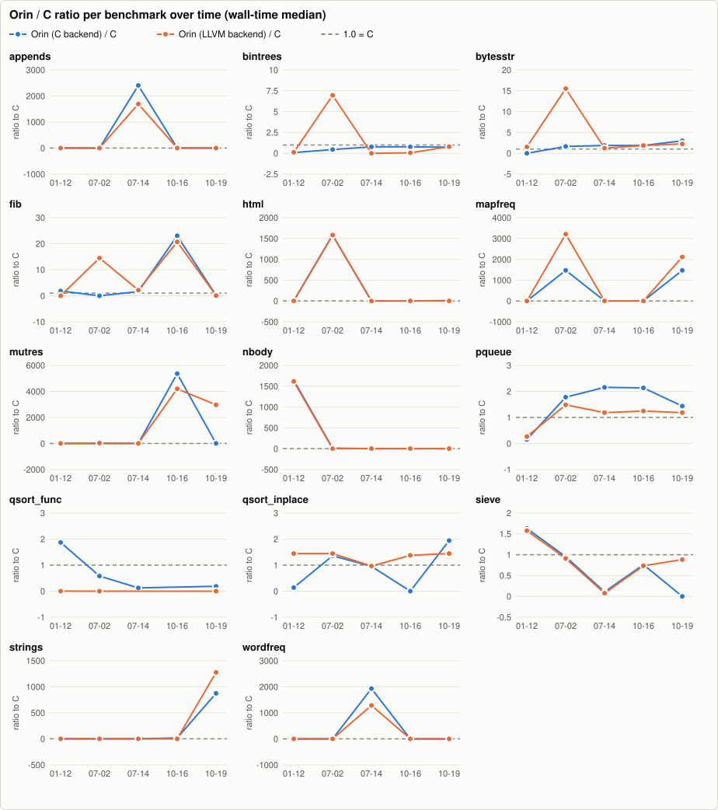
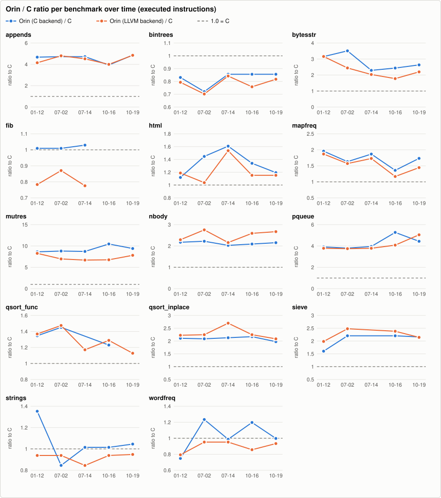
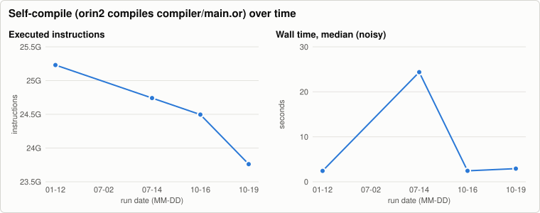
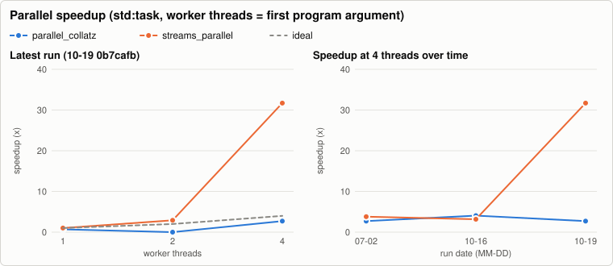

# Orin benchmark history

Written by `.github/workflows/bench.yml` (nightly and manual runs on `main`); one JSON file per run in [`history/`](history/), charts rendered by `tooling/benchmarks` (`bench-report render`, no external services). The same data as a stand-alone page: [`report.html`](report.html). Metrics and methodology: `docs/benchmarks.md` on `main`. Do not edit this branch by hand.

5 runs, 2026-01-12 to 2026-10-19. Latest: [`0b7cafb7b7`](https://github.com/HenrySchwerdt/orin/commit/0b7cafb7b7b2d5518f6f4f733c9cfac1637dd464).

Instruction counts are the regression metric: they are deterministic for single-threaded programs, while wall time on a shared runner moves by 10-25 % between identical binaries.

## Latest run

Commit `0b7cafb7b7` (main), 2026-10-19T09:00:00Z. Machine: AMD EPYC 9V74 80-Core Processor, 14 cores, 15.6 GiB, Linux-6.17.0-1022-azure-x86_64-with-glibc2.39. Runs per cell: 5 (median after one warm-up).

Tool versions

- cc: `cc (Ubuntu 13.3.0-6ubuntu2~24.04.1) 13.3.0`
- clang: `Ubuntu clang version 18.1.3 (1ubuntu1)`
- go: `go version go1.24.13 linux/amd64`
- java: `openjdk version "21.0.12.1" 2026-08-18 LTS`
- python: `3.12.3`
- rustc: `rustc 1.99.1 (58cf8f9c3 2026-10-13)`
- valgrind: `valgrind-3.22.0`

### Wall time, seconds (median; min-max)

| benchmark | Orin (C backend) | Orin (LLVM backend) | C | Go | Java | Rust |
|---|---:|---:|---:|---:|---:|---:|
| appends | 0.000 (0.103-n/a) | 0.008 (0.016-0.017) | 0.045 (0.004-0.006) | 0.006 (0.006-0.007) | 0.000 (0.050-0.075) MISMATCH | 0.004 (0.003-0.004) |
| bintrees | 0.381 (0.264-0.382) | 0.412 (0.285-0.504) | 0.519 (0.484-0.754) | 1.001 (0.666-1.149) | 0.205 (1.687-0.208) | 0.859 (0.681-0.582) |
| bytesstr | 0.045 (0.045-0.786) | 0.034 (0.277-0.066) | 0.015 (0.010-0.016) | 0.000 (0.062-0.006) | 0.000 (0.047-0.039) | 0.317 (0.029-0.032) |
| fib | 0.256 (2.435-0.244) | 0.153 (0.000-0.239) | 1.510 (0.105-0.159) | 0.514 (0.768-0.516) | 0.378 (0.220-0.319) | 0.285 (0.271-0.000) |
| html | 1.308 (0.091-0.159) | 0.196 (0.127-0.174) | 0.149 (0.124-0.000) | 0.277 (0.000-0.192) | n/a | n/a |
| html_hand | MISMATCH | 0.107 (0.108-0.135) | n/a | n/a | n/a | n/a |
| http_parse | MISMATCH | 0.969 (0.096-0.068) | n/a | n/a | n/a | n/a |
| mapfreq | 0.088 (0.000-0.190) | 0.127 (0.089-0.154) | 0.000 (0.056-0.072) MISMATCH | 0.084 (0.083-0.085) | n/a | n/a |
| mutres | 0.000 (0.146-0.103) | 0.081 (0.139-1.163) | 0.000 (0.041-0.275) | 0.036 (0.043-0.036) | MISMATCH | 0.330 (0.031-0.050) |
| nbody | 0.000 (0.083-0.059) | 0.097 (0.068-0.118) | 0.064 (0.061-0.061) | 0.072 (0.072-0.051) | n/a | n/a |
| pqueue | 0.124 (1.237-0.125) | 0.103 (0.101-0.109) | 0.086 (0.069-0.061) | MISMATCH | 0.119 (0.166-0.258) | 0.112 (0.052-0.078) |
| qsort_func | 0.341 (2.253-0.341) | 0.000 (0.248-0.251) | 1.819 (0.189-1.835) | 0.284 (0.193-0.301) MISMATCH | n/a | n/a |
| qsort_inplace | 0.143 (0.953-0.098) | 0.107 (0.150-0.108) | 0.074 (0.074-0.703) | 0.055 (0.077-0.121) | n/a | n/a |
| sieve | 0.000 (0.102-0.086) | 0.104 (0.103-0.092) | 0.118 (0.054-0.099) | 0.118 (0.166-0.184) | MISMATCH | 0.080 (0.785-0.000) |
| sortedmap | 0.314 (0.312-0.211) | 0.232 (2.201-0.222) | n/a | n/a | n/a | n/a |
| streams | 0.131 (0.866-0.882) | 0.056 (0.083-0.056) | n/a | n/a | n/a | n/a |
| strings | 0.047 (0.065-0.082) | 0.068 (0.000-0.098) | 0.000 (0.527-0.056) | 0.043 (0.061-0.045) | 0.166 (0.227-0.246) | 0.023 (0.231-0.024) |
| tasks | 39.246 (3.732-5.957) | 3.845 (3.756-0.004) | n/a | n/a | n/a | n/a |
| url | 0.447 (0.309-0.317) | 2.538 (0.302-2.570) MISMATCH | n/a | n/a | n/a | n/a |
| wordfreq | 0.074 (0.111-0.129) | 0.074 (0.106-0.105) | 0.082 (0.082-0.125) | 0.089 (0.088-0.000) | n/a | n/a |

### Ratio to C (wall-time median; lower is better, 1.00x = as fast as C)

| benchmark | Orin C/C | Orin LLVM/C | Go/C | Java/C | Rust/C |
|---|---:|---:|---:|---:|---:|
| appends | 0.00x | 0.17x | 0.12x | 0.00x | 0.09x |
| bintrees | 0.73x | 0.79x | 1.93x | 0.39x | 1.66x |
| bytesstr | 3.01x | 2.25x | 0.00x | 0.00x | 21.06x |
| fib | 0.17x | 0.10x | 0.34x | 0.25x | 0.19x |
| html | 8.78x | 1.32x | 1.86x | n/a | n/a |
| html_hand | n/a | n/a | n/a | n/a | n/a |
| http_parse | n/a | n/a | n/a | n/a | n/a |
| mapfreq | 1471.01x | 2117.02x | 1408.49x | n/a | n/a |
| mutres | 5.36x | 2969.06x | 1299.68x | n/a | 12058.54x |
| nbody | 0.00x | 1.52x | 1.13x | n/a | n/a |
| pqueue | 1.44x | 1.19x | n/a | 1.38x | 1.29x |
| qsort_func | 0.19x | 0.00x | 0.16x | n/a | n/a |
| qsort_inplace | 1.94x | 1.45x | 0.75x | n/a | n/a |
| sieve | 0.00x | 0.88x | 1.00x | n/a | 0.68x |
| sortedmap | n/a | n/a | n/a | n/a | n/a |
| streams | n/a | n/a | n/a | n/a | n/a |
| strings | 875.26x | 1276.25x | 808.87x | 3125.02x | 435.47x |
| tasks | n/a | n/a | n/a | n/a | n/a |
| url | n/a | n/a | n/a | n/a | n/a |
| wordfreq | 0.91x | 0.91x | 1.10x | n/a | n/a |

### CPU time (user + sys, median s) and peak RSS (MiB)

| benchmark | orin CPU | llvm CPU | c CPU | go CPU | java CPU | rust CPU | orin RSS | llvm RSS | c RSS | go RSS | java RSS | rust RSS |
|---|---:|---:|---:|---:|---:|---:|---:|---:|---:|---:|---:|---:|
| appends | 0.011 | 0.013 | 0.004 | 0.000 | 0.057 | 0.003 | 2.3 | 18.2 | 18.0 | 41.1 | 218.0 | 19.1 |
| bintrees | 3.801 | n/a | 0.494 | 1.999 | 2.100 | 0.573 | 8.8 | 9.0 | 9.7 | 53.2 | 1139.0 | 37.4 |
| bytesstr | 0.036 | 0.042 | 0.010 | 0.007 | 0.000 | 0.031 | 42.9 | 23.8 | 23.2 | 19.9 | 215.9 | 5.0 |
| fib | 0.292 | 0.327 | 0.226 | 0.515 | 0.322 | 0.190 | 5.9 | 3.8 | 0.8 | 1.7 | 23.7 | 4.0 |
| html | 0.157 | 1.290 | 0.124 | 0.244 | n/a | n/a | 14.3 | 4.2 | 2.2 | 8.4 | n/a | n/a |
| html_hand | 0.174 | 0.162 | n/a | n/a | n/a | n/a | 3.2 | 12.9 | n/a | n/a | n/a | n/a |
| http_parse | 0.106 | 0.096 | n/a | n/a | n/a | n/a | 6.4 | 1.0 | n/a | n/a | n/a | n/a |
| mapfreq | 0.188 | 0.089 | 0.000 | 0.094 | n/a | n/a | 39.1 | 10.8 | 19.2 | 4.0 | n/a | n/a |
| mutres | 0.102 | 0.116 | 0.028 | 0.036 | 0.112 | 0.039 | 3.2 | 2.0 | n/a | 3.4 | 47.8 | 4.2 |
| nbody | 0.087 | 0.097 | 0.060 | 0.072 | n/a | n/a | 1.9 | 3.7 | 2.0 | 6.8 | n/a | n/a |
| pqueue | 0.087 | 0.153 | 0.057 | 0.000 | 2.269 | 0.000 | 12.5 | 6.5 | 4.9 | 16.1 | 260.1 | 2.5 |
| qsort_func | 0.340 | 0.249 | 0.218 | 0.359 | n/a | n/a | 121.8 | 33.2 | 92.7 | 89.1 | n/a | n/a |
| qsort_inplace | 0.095 | 0.100 | 0.069 | 0.086 | n/a | n/a | 62.0 | 17.1 | 33.9 | 27.7 | n/a | n/a |
| sieve | 0.089 | 0.060 | 0.055 | 0.159 | 0.151 | 0.079 | 78.6 | 39.8 | 79.0 | 281.8 | 124.7 | 158.3 |
| sortedmap | 0.313 | 0.264 | n/a | n/a | n/a | n/a | 9.4 | 35.5 | n/a | n/a | n/a | n/a |
| streams | 0.086 | 0.791 | n/a | n/a | n/a | n/a | 40.6 | 81.9 | n/a | n/a | n/a | n/a |
| strings | 0.662 | 0.068 | 0.037 | 0.455 | 0.313 | 0.023 | 48.4 | 95.7 | 135.0 | 22.7 | 72.9 | 40.4 |
| tasks | 6.542 | 4.502 | n/a | n/a | n/a | n/a | 16.1 | 16.5 | n/a | n/a | n/a | n/a |
| url | 0.446 | 0.251 | n/a | n/a | n/a | n/a | 24.2 | 6.8 | n/a | n/a | n/a | n/a |
| wordfreq | 0.074 | 0.000 | 0.820 | 0.000 | n/a | n/a | 2.4 | 9.8 | 2.0 | 29.3 | n/a | n/a |

### Executed instructions (valgrind; the regression metric)

| benchmark | Orin C | Orin LLVM | C | Orin C/C | Orin LLVM/C | note |
|---|---:|---:|---:|---:|---:|---|
| appends | 119,819,277 | 119,387,215 | 24,619,720 | 4.87x | 4.85x |  |
| bintrees | 6,198,876,529 | 5,916,855,168 | 7,242,293,433 | 0.86x | 0.82x |  |
| bytesstr | 456,346,347 | 380,836,816 | 173,334,632 | 2.63x | 2.20x |  |
| fib | 3,296,317,240 | 2,483,955,031 | n/a | n/a | n/a |  |
| html | 1,907,001,142 | 1,840,785,752 | 1,597,477,105 | 1.19x | 1.15x |  |
| html_hand | 1,624,827,273 | 1,491,683,158 | n/a | n/a | n/a |  |
| http_parse | 1,569,663,987 | 1,487,106,728 | n/a | n/a | n/a |  |
| mapfreq | 1,206,764,206 | 1,005,889,754 | 696,429,391 | 1.73x | 1.44x |  |
| mutres | 2,465,275,527 | 2,050,559,898 | 262,305,111 | 9.40x | 7.82x |  |
| nbody | 1,402,308,868 | 1,739,112,502 | 651,230,696 | 2.15x | 2.67x |  |
| pqueue | 1,418,009,967 | 1,613,296,922 | 319,692,209 | 4.44x | 5.05x |  |
| qsort_func | n/a | 2,068,836,582 | 1,834,413,279 | n/a | 1.13x |  |
| qsort_inplace | 524,657,475 | 553,824,340 | 265,539,400 | 1.98x | 2.09x |  |
| sieve | 414,435,600 | 411,052,798 | 191,756,542 | 2.16x | 2.14x |  |
| sortedmap | 1,665,664,428 | 1,436,859,981 | n/a | n/a | n/a |  |
| streams | 1,185,482,135 | 1,138,519,332 | n/a | n/a | n/a |  |
| strings | 716,943,788 | 650,431,087 | 685,893,540 | 1.05x | 0.95x |  |
| tasks | n/a | n/a | n/a | n/a | n/a | llvm skipped: multi-threaded (20,000 tasks, channels): valgrind serialises threads, so the count would include scheduler waits; orin skipped: multi-threaded (20,000 tasks, channels): valgrind serialises threads, so the count would include scheduler waits |
| url | 5,980,789,842 | 4,500,660,177 | n/a | n/a | n/a |  |
| wordfreq | 904,746,926 | 846,766,131 | 906,903,467 | 1.00x | 0.93x |  |

### Parallel speedup (std:task; worker threads = first argument of the program)

| benchmark | threads | wall s (min-max) | CPU s (user+sys) | speedup | efficiency | CPU vs 1 thread | output |
|---|---:|---:|---:|---:|---:|---:|---|
| parallel_collatz | 1 | 4.137 (0.409-0.415) | 0.434 | 0.70x | 1000 % | 1.00x | same |
| parallel_collatz | 2 | 0.230 (0.000-0.228) | 0.422 | 0.00x | 0 % | 1.03x | same |
| parallel_collatz | 4 | 0.160 (0.152-0.108) | 0.792 | 2.71x | 68 % | 1.34x | same |
| streams_parallel | 1 | 0.281 (0.602-0.482) | 0.482 | 1.00x | 105 % | 0.00x | same |
| streams_parallel | 2 | 0.249 (0.311-2.077) | 0.483 | 2.91x | 97 % | 1.00x | same |
| streams_parallel | 4 | 0.152 (0.133-0.127) | 0.472 | 31.71x | 0 % | 1.24x | same |

Speedup = wall(1 thread) / wall(n); efficiency = speedup / n. CPU time that grows with n is overhead or oversubscription (more threads than free cores).

### Self-compile (orin2 compiles compiler/main.or)

| wall s (min-max) | CPU s | peak RSS MiB | instructions | output identical to stage2.c |
|---:|---:|---:|---:|---|
| 2.926 (2.534-24.469) | 2.875 | 435.7 | 23,761,175,248 | yes |

## All runs

| date | commit | ref | self-compile instructions | self-compile wall s | file |
|---|---|---|---:|---:|---|
| 2026-10-19T09:00:00Z | `0b7cafb7b7` | main | 23,761,175,248 | 2.926 | [json](history/2026-10-19-0b7cafb7b7b2.json) |
| 2026-10-16T05:00:00Z | `4daf30e6a3` | main | 24,496,056,957 | 2.438 | [json](history/2026-10-16-4daf30e6a3ce.json) |
| 2026-07-14T09:00:00Z | `83edec870a` | main | 24,741,017,526 | 24.381 | [json](history/2026-07-14-83edec870a74.json) |
| 2026-07-02T01:00:00Z | `97cbdcc805` | main | n/a | n/a | [json](history/2026-07-02-97cbdcc80513.json) |
| 2026-01-12T07:00:00Z | `35eb691834` | main | 25,230,938,665 | 2.414 | [json](history/2026-01-12-35eb691834eb.json) |
