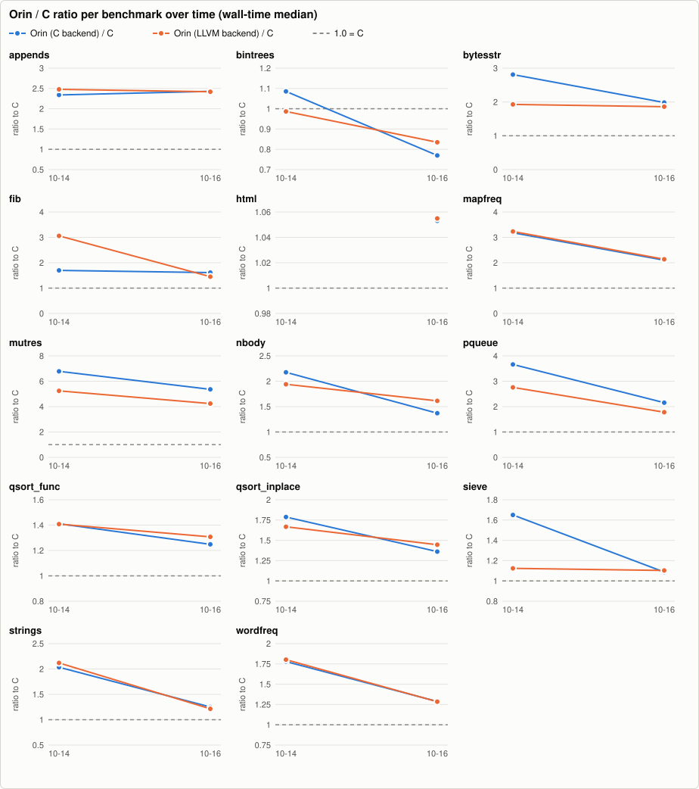
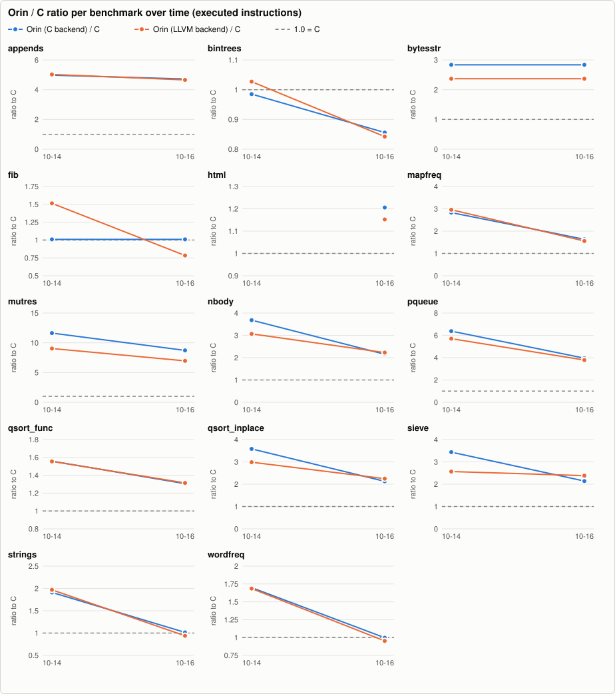
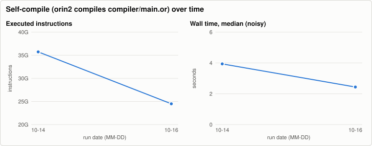
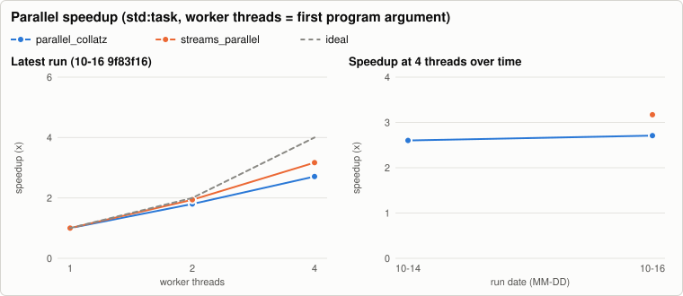

# Orin benchmark history

Written by `.github/workflows/bench.yml` (nightly and manual runs on `main`); one JSON file per run in [`history/`](history/), charts rendered by `tooling/benchmarks` (`bench-report render`, no external services). The same data as a stand-alone page: [`report.html`](report.html). Metrics and methodology: `docs/benchmarks.md` on `main`. Do not edit this branch by hand.

2 runs, 2026-10-14 to 2026-10-16. Latest: [`9f83f16af4`](https://github.com/orin-lang/orin-lang/commit/9f83f16af40241f235b3652208e703af6b084374).

Instruction counts are the regression metric: they are deterministic for single-threaded programs, while wall time on a shared runner moves by 10-25 % between identical binaries.

## Latest run

Commit `9f83f16af4` (main), 2026-10-16T08:55:17Z. Machine: AMD EPYC 9V74 80-Core Processor, 4 cores, 15.6 GiB, Linux-6.17.0-1022-azure-x86_64-with-glibc2.39. Runs per cell: 5 (median after one warm-up).

Tool versions

- cc: `cc (Ubuntu 13.3.0-6ubuntu2~24.04.1) 13.3.0`
- clang: `Ubuntu clang version 18.1.3 (1ubuntu1)`
- go: `go version go1.24.13 linux/amd64`
- java: `openjdk version "21.0.12.1" 2026-08-18 LTS`
- python: `3.12.3`
- rustc: `rustc 1.99.1 (58cf8f9c3 2026-10-13)`
- valgrind: `valgrind-3.22.0`

### Wall time, seconds (median; min-max)

| benchmark | Orin (C backend) | Orin (LLVM backend) | C | Go | Java | Rust |
|---|---:|---:|---:|---:|---:|---:|
| appends | 0.011 (0.010-0.016) | 0.011 (0.011-0.014) | 0.005 (0.004-0.005) | 0.006 (0.005-0.007) | 0.060 (0.050-0.063) | 0.003 (0.003-0.004) |
| bintrees | 0.381 (0.377-0.386) | 0.412 (0.407-0.420) | 0.494 (0.484-0.503) | 0.953 (0.951-0.957) | 0.171 (0.169-0.173) | 0.573 (0.568-0.582) |
| bytesstr | 0.030 (0.030-0.079) | 0.028 (0.028-0.063) | 0.015 (0.015-0.016) | 0.007 (0.006-0.008) | 0.051 (0.047-0.056) | 0.032 (0.029-0.032) |
| fib | 0.244 (0.244-0.244) | 0.219 (0.218-0.228) | 0.151 (0.151-0.151) | 0.514 (0.512-0.516) | 0.315 (0.314-0.319) | 0.271 (0.271-0.271) |
| html | 0.131 (0.130-0.132) | 0.131 (0.127-0.145) | 0.124 (0.124-0.124) | 0.184 (0.179-0.192) | n/a | n/a |
| html_hand | 0.116 (0.116-0.118) | 0.108 (0.108-0.112) | n/a | n/a | n/a | n/a |
| http_parse | 0.107 (0.106-0.107) | 0.097 (0.097-0.097) | n/a | n/a | n/a | n/a |
| mapfreq | 0.126 (0.126-0.127) | 0.128 (0.127-0.128) | 0.060 (0.056-0.060) | 0.084 (0.084-0.085) | n/a | n/a |
| mutres | 0.147 (0.146-0.147) | 0.116 (0.116-0.116) | 0.027 (0.027-0.028) | 0.036 (0.036-0.036) | 0.068 (0.065-0.071) | 0.033 (0.032-0.033) |
| nbody | 0.083 (0.083-0.084) | 0.098 (0.098-0.098) | 0.061 (0.061-0.061) | 0.072 (0.072-0.073) | n/a | n/a |
| pqueue | 0.124 (0.124-0.125) | 0.103 (0.102-0.103) | 0.058 (0.057-0.058) | 0.155 (0.153-0.158) | 0.171 (0.166-0.172) | 0.075 (0.075-0.075) |
| qsort_func | 0.227 (0.225-0.227) | 0.238 (0.237-0.240) | 0.182 (0.180-0.183) | 0.287 (0.275-0.301) | n/a | n/a |
| qsort_inplace | 0.096 (0.095-0.098) | 0.102 (0.100-0.102) | 0.070 (0.070-0.070) | 0.079 (0.078-0.081) | n/a | n/a |
| sieve | 0.085 (0.085-0.087) | 0.087 (0.086-0.087) | 0.078 (0.078-0.082) | 0.118 (0.110-0.123) | 0.126 (0.123-0.126) | 0.080 (0.078-0.091) |
| sortedmap | 0.209 (0.208-0.211) | 0.221 (0.220-0.222) | n/a | n/a | n/a | n/a |
| streams | 0.087 (0.087-0.088) | 0.079 (0.079-0.080) | n/a | n/a | n/a | n/a |
| strings | 0.067 (0.066-0.068) | 0.065 (0.064-0.065) | 0.053 (0.053-0.053) | 0.041 (0.040-0.043) | 0.158 (0.151-0.164) | 0.023 (0.023-0.024) |
| tasks | 3.925 (3.732-3.971) | 3.845 (3.756-3.916) | n/a | n/a | n/a | n/a |
| url | 0.298 (0.294-0.317) | 0.254 (0.251-0.257) | n/a | n/a | n/a | n/a |
| wordfreq | 0.106 (0.106-0.107) | 0.106 (0.106-0.106) | 0.082 (0.082-0.083) | 0.089 (0.088-0.235) | n/a | n/a |

### Ratio to C (wall-time median; lower is better, 1.00x = as fast as C)

| benchmark | Orin C/C | Orin LLVM/C | Go/C | Java/C | Rust/C |
|---|---:|---:|---:|---:|---:|
| appends | 2.43x | 2.42x | 1.26x | 13.19x | 0.76x |
| bintrees | 0.77x | 0.83x | 1.93x | 0.34x | 1.16x |
| bytesstr | 1.98x | 1.86x | 0.46x | 3.32x | 2.08x |
| fib | 1.61x | 1.45x | 3.40x | 2.08x | 1.80x |
| html | 1.05x | 1.05x | 1.49x | n/a | n/a |
| html_hand | n/a | n/a | n/a | n/a | n/a |
| http_parse | n/a | n/a | n/a | n/a | n/a |
| mapfreq | 2.10x | 2.14x | 1.41x | n/a | n/a |
| mutres | 5.36x | 4.24x | 1.31x | 2.47x | 1.21x |
| nbody | 1.37x | 1.61x | 1.19x | n/a | n/a |
| pqueue | 2.15x | 1.78x | 2.70x | 2.96x | 1.29x |
| qsort_func | 1.25x | 1.31x | 1.58x | n/a | n/a |
| qsort_inplace | 1.36x | 1.45x | 1.12x | n/a | n/a |
| sieve | 1.09x | 1.10x | 1.50x | 1.61x | 1.02x |
| sortedmap | n/a | n/a | n/a | n/a | n/a |
| streams | n/a | n/a | n/a | n/a | n/a |
| strings | 1.25x | 1.22x | 0.77x | 2.98x | 0.44x |
| tasks | n/a | n/a | n/a | n/a | n/a |
| url | n/a | n/a | n/a | n/a | n/a |
| wordfreq | 1.29x | 1.28x | 1.09x | n/a | n/a |

### CPU time (user + sys, median s) and peak RSS (MiB)

| benchmark | orin CPU | llvm CPU | c CPU | go CPU | java CPU | rust CPU | orin RSS | llvm RSS | c RSS | go RSS | java RSS | rust RSS |
|---|---:|---:|---:|---:|---:|---:|---:|---:|---:|---:|---:|---:|
| appends | 0.011 | 0.011 | 0.004 | 0.007 | 0.081 | 0.003 | 4.6 | 4.9 | 4.9 | 11.1 | 58.9 | 5.2 |
| bintrees | 0.380 | 0.412 | 0.494 | 2.019 | 0.210 | 0.573 | 17.6 | 18.0 | 9.7 | 14.4 | 307.8 | 10.1 |
| bytesstr | 0.030 | 0.028 | 0.015 | 0.010 | 0.066 | 0.031 | 11.6 | 11.9 | 11.6 | 9.9 | 107.9 | 5.0 |
| fib | 0.243 | 0.218 | 0.151 | 0.515 | 0.325 | 0.271 | 1.6 | 1.9 | 1.6 | 3.4 | 47.5 | 2.0 |
| html | 0.130 | 0.129 | 0.124 | 0.244 | n/a | n/a | 3.9 | 4.2 | 2.2 | 8.4 | n/a | n/a |
| html_hand | 0.116 | 0.108 | n/a | n/a | n/a | n/a | 3.2 | 3.5 | n/a | n/a | n/a | n/a |
| http_parse | 0.106 | 0.096 | n/a | n/a | n/a | n/a | 1.7 | 2.0 | n/a | n/a | n/a | n/a |
| mapfreq | 0.125 | 0.128 | 0.059 | 0.094 | n/a | n/a | 10.6 | 10.8 | 5.2 | 8.0 | n/a | n/a |
| mutres | 0.146 | 0.116 | 0.027 | 0.036 | 0.093 | 0.033 | 1.6 | 2.0 | 1.6 | 3.4 | 47.8 | 2.1 |
| nbody | 0.083 | 0.098 | 0.060 | 0.072 | n/a | n/a | 1.9 | 1.9 | 2.0 | 3.4 | n/a | n/a |
| pqueue | 0.124 | 0.102 | 0.057 | 0.160 | 0.227 | 0.074 | 6.2 | 6.5 | 4.9 | 16.1 | 70.3 | 5.1 |
| qsort_func | 0.227 | 0.237 | 0.182 | 0.342 | n/a | n/a | 32.9 | 33.2 | 25.1 | 44.6 | n/a | n/a |
| qsort_inplace | 0.095 | 0.101 | 0.070 | 0.087 | n/a | n/a | 16.8 | 17.1 | 16.9 | 27.7 | n/a | n/a |
| sieve | 0.085 | 0.086 | 0.078 | 0.161 | 0.151 | 0.079 | 78.6 | 79.7 | 79.0 | 281.8 | 124.7 | 79.1 |
| sortedmap | 0.209 | 0.220 | n/a | n/a | n/a | n/a | 9.4 | 9.6 | n/a | n/a | n/a | n/a |
| streams | 0.087 | 0.079 | n/a | n/a | n/a | n/a | 40.6 | 41.0 | n/a | n/a | n/a | n/a |
| strings | 0.066 | 0.064 | 0.053 | 0.045 | 0.316 | 0.023 | 48.4 | 47.9 | 36.5 | 22.7 | 145.8 | 20.2 |
| tasks | 4.361 | 4.288 | n/a | n/a | n/a | n/a | 16.1 | 16.5 | n/a | n/a | n/a | n/a |
| url | 0.297 | 0.253 | n/a | n/a | n/a | n/a | 6.5 | 6.8 | n/a | n/a | n/a | n/a |
| wordfreq | 0.106 | 0.105 | 0.082 | 0.091 | n/a | n/a | 2.4 | 2.7 | 2.0 | 7.9 | n/a | n/a |

### Executed instructions (valgrind; the regression metric)

| benchmark | Orin C | Orin LLVM | C | Orin C/C | Orin LLVM/C | note |
|---|---:|---:|---:|---:|---:|---|
| appends | 119,819,277 | 118,205,164 | 25,381,155 | 4.72x | 4.66x |  |
| bintrees | 6,198,876,529 | 6,099,850,689 | 7,242,293,433 | 0.86x | 0.84x |  |
| bytesstr | 507,051,497 | 423,152,018 | 178,695,497 | 2.84x | 2.37x |  |
| fib | 3,200,308,000 | 2,483,955,031 | 3,170,983,196 | 1.01x | 0.78x |  |
| html | 1,907,001,142 | 1,822,560,151 | 1,581,660,500 | 1.21x | 1.15x |  |
| html_hand | 1,608,739,875 | 1,537,817,689 | n/a | n/a | n/a |  |
| http_parse | 1,744,071,097 | 1,652,340,809 | n/a | n/a | n/a |  |
| mapfreq | 1,171,615,734 | 1,117,655,283 | 717,968,445 | 1.63x | 1.56x |  |
| mutres | 2,541,521,162 | 2,030,257,325 | 291,450,124 | 8.72x | 6.97x |  |
| nbody | 1,402,308,868 | 1,449,260,419 | 651,230,696 | 2.15x | 2.23x |  |
| pqueue | 1,403,970,265 | 1,344,414,102 | 355,213,566 | 3.95x | 3.78x |  |
| qsort_func | 1,996,458,292 | 2,008,579,206 | 1,528,677,733 | 1.31x | 1.31x |  |
| qsort_inplace | 582,952,750 | 615,360,378 | 273,751,959 | 2.13x | 2.25x |  |
| sieve | 410,332,278 | 456,725,332 | 191,756,542 | 2.14x | 2.38x |  |
| sortedmap | 1,388,053,690 | 1,395,009,691 | n/a | n/a | n/a |  |
| streams | 1,173,744,689 | 1,173,731,271 | n/a | n/a | n/a |  |
| strings | 696,061,931 | 643,991,176 | 685,893,540 | 1.01x | 0.94x |  |
| tasks | n/a | n/a | n/a | n/a | n/a | llvm skipped: multi-threaded (20,000 tasks, channels): valgrind serialises threads, so the count would include scheduler waits; orin skipped: multi-threaded (20,000 tasks, channels): valgrind serialises threads, so the count would include scheduler waits |
| url | 4,983,991,535 | 4,500,660,177 | n/a | n/a | n/a |  |
| wordfreq | 878,395,074 | 838,382,308 | 880,488,803 | 1.00x | 0.95x |  |

### Parallel speedup (std:task; worker threads = first argument of the program)

| benchmark | threads | wall s (min-max) | CPU s (user+sys) | speedup | efficiency | CPU vs 1 thread | output |
|---|---:|---:|---:|---:|---:|---:|---|
| parallel_collatz | 1 | 0.414 (0.413-0.415) | 0.413 | 1.00x | 100 % | 1.00x | same |
| parallel_collatz | 2 | 0.230 (0.229-0.230) | 0.426 | 1.80x | 90 % | 1.03x | same |
| parallel_collatz | 4 | 0.153 (0.152-0.154) | 0.528 | 2.71x | 68 % | 1.28x | same |
| streams_parallel | 1 | 0.402 (0.402-0.402) | 0.401 | 1.00x | 100 % | 1.00x | same |
| streams_parallel | 2 | 0.207 (0.207-0.208) | 0.403 | 1.94x | 97 % | 1.00x | same |
| streams_parallel | 4 | 0.127 (0.127-0.127) | 0.472 | 3.17x | 79 % | 1.18x | same |

Speedup = wall(1 thread) / wall(n); efficiency = speedup / n. CPU time that grows with n is overhead or oversubscription (more threads than free cores).

### Self-compile (orin2 compiles compiler/main.or)

| wall s (min-max) | CPU s | peak RSS MiB | instructions | output identical to stage2.c |
|---:|---:|---:|---:|---|
| 2.438 (2.413-2.447) | 2.396 | 217.9 | 24,496,056,957 | yes |

## All runs

| date | commit | ref | self-compile instructions | self-compile wall s | file |
|---|---|---|---:|---:|---|
| 2026-10-16T08:55:17Z | `9f83f16af4` | main | 24,496,056,957 | 2.438 | [json](history/2026-10-16-9f83f16af402.json) |
| 2026-10-14T17:32:27Z | `f837889af7` | main | 35,729,157,194 | 3.937 | [json](history/2026-10-14-f837889af7a9.json) |
